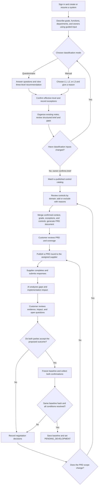
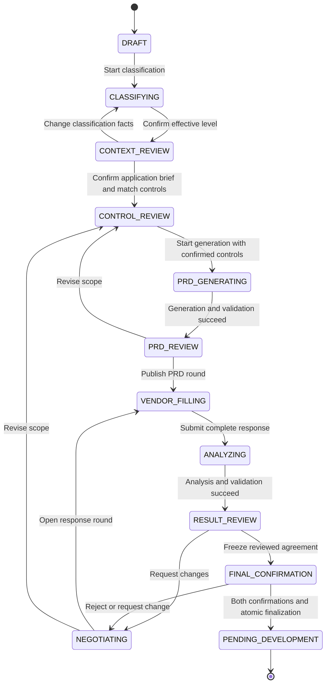
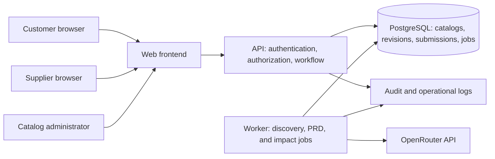
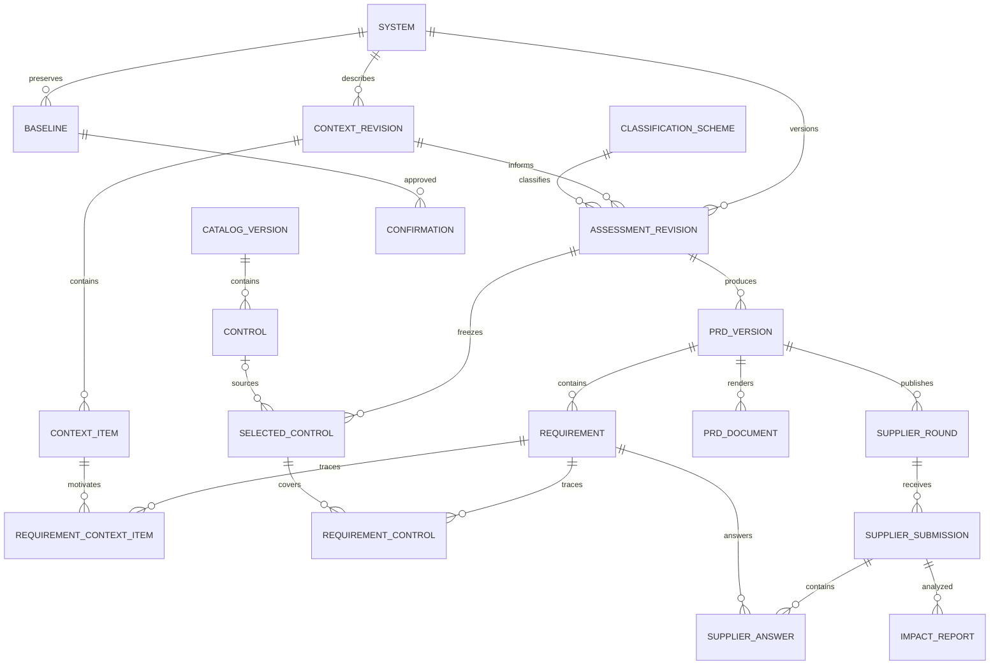

> 2026-11-05 补充：来源高风险的待澄清项也必须由负责人逐项决定；可接受并记录责任理由，或要求澄清。批量操作跳过这些项；决定绑定当前提交和报告，不修改来源风险、供应商答复或独立双签要求。
>
> English: source-High clarification requires an individual owner decision. Acceptance requires a rationale and is bound to the current submission/report; bulk actions skip it.

> 2026-11-05：供应商提交复核后仅保存不可变答复，直接进入负责人复核，不自动调用 AI 或排队影响分析。负责人默认查看开发项确认比例、部分/无法完成/待澄清数量，以及固定来源中高风险未确认项；后续规则/AI 审查按需显式发起，原双签及风险门槛保留。无需迁移或重置数据。详见[供应商协同说明](docs/supplier-prd-delivery.md)。
>
> English: submission now shows a pinned commitment summary without automatic analysis. Subsequent rule/model review is explicit; existing review gates and independent baseline confirmations remain intact.

> 2026-11-05：AmerSports-2.18 / 规则引擎1.8.2 移除原定级 G02（来源 B03，`independent_business`）及其 QA01 边界复核规则。定级页现为14题，展示编号顺延为 G01–G14；缺失、否、不确定均不再触发该题的必填或复核。历史答案、说明、已确认结果及基线保留；重新计算使用新规则。责任主体校验继续有效，无需数据迁移或重置。
>
> English: The former G02 independent-business question and its QA01 review rule are retired. Grading now has 14 questions. Historical answers and confirmed snapshots remain intact; new calculations ignore this field. Responsibility checks remain active.

> 2026-11-04：移除独立系统信息录入步骤；确认分级后直接审查应用说明。历史 discovery 链接重定向；无历史描述时从已确认问卷预填，保留人工补齐与确认。

> 当前 AmerSports-2.16 / 规则引擎1.8.0：只以当前可见问卷字段进行分级。退役 B11 承载对象、B12 特殊边界及大数据平台适用性题，取消承载下限和相关结果卡片。历史答案保存但不参与当前结果。B04 对接等级、D01 数据类别明细仍按所选答案展开；未展开的旧答案不影响等级或复核。E09/E10 仅校验当前所选客体，其他客体不再要求补答或理由。旧个人信息开关不再决定当前字段显示或规则。Current grading uses visible questionnaire inputs only; historical answers remain stored.

> D03 已改为条件显示的人数范围，原 D04 主体人数移除，数据量使用双范围下拉框；旧数字和记录保留，规则按范围边界处理。

> A04 综合描述已拆为 A04 建设目的、A05 业务功能、A06 使用场景，三题独立 AI 优化；A07 为业务类型。旧描述保留只读查阅。

> F 组影响录入已改为两个下拉框组合，按业务信息/系统服务分别添加客体与程度；原六项字段、理由、未知处理和矩阵不变。

> 当前问卷已移除 G 章节：A–F 六章节、56 道有效题；历史答案保留，未填 G 项不再阻止提交。

> 网络信息已拆分为 B07–B10 四题，当前有效题共63道；旧描述及附件保留。

> A03 已支持按部门填写对接人，A04 已接入显式 AI 描述优化；实现与数据契约见 mlps-intake 说明。

> 当前问卷 AmerSports-2.1：60 道有效题、A–G 七章节；界面与校验调整见 docs/mlps-intake.md。

> 当前问卷已更新为 Amer Sports 场景版 2.0：70 道有效题、连续章节编号、业务选项和逐题填写参考；历史字段和答案保留。

> 2026-11-03：当前定级信息收集已更换为 MLPS V1.0 八步问卷；旧初筛界面退役、历史数据保留。见 [实现与使用说明](docs/mlps-intake.md)。

> 2026-11-03 Demo: 项目机制和控制库写入入口已停用；使用直接评估、CN MLPS 来源库和 PRD v2。Current behavior: [更新说明 / Current contract](docs/direct-assessment-mlps.md).

# System assessment and supplier collaboration: development specification

## 2026-10-29: administrator and project-manager authority

Administrators have full customer-side access to every assessment in their organization,
including progress, editing, review, role grants and direct task assignment. No manager
membership or second assignment by a manager is required for administrators.
Managers have full customer-side permissions within their assigned projects and can
replace or revoke operator, reviewer, viewer and supplier memberships. They cannot grant
manager/admin privileges or modify accounts that are administrators or managers.
Ordinary operators/reviewers still require task assignment and retain contribution checks.
Administrator/manager customer actions can span editing, review and final confirmation;
independent supplier identity, same-hash confirmations, source and version checks remain mandatory.
Project and task assignment is centralized in the left navigation's Projects & assignments
page, with existing assessment selection, instead of repeating on each workflow stage.
Account creation, password resets, activation and organization administration remain admin-only.
No migration or runtime-data reset is required.


Date: 2026-10-19. Status: local working release with an acceptance specification.

2026-10-25 implementation update: the versioned MLPS tag/control-library path is described
in [the maintenance guide](docs/control-library.md) and [the design plan](docs/mlps-tagging-development-plan.md).
It adds manual and XLSX control maintenance, draft review/publication, configurable
questions and deterministic conditions, catalog upgrades, and immutable source metadata.
The older SYS-RISK/R1 questionnaire and CSV contract below remain historical acceptance
fixtures. New configuration is published explicitly; MLPS source levels and internal
L1/L2/L3 risk levels are separate. The current new UI has system-level facts with mixed
hosting selections; independent component-scoped matching remains future work.

The platform takes a customer system through guided discovery, three-level
classification, confirmed application context, control review, PRD document generation,
supplier responses, impact analysis, and joint confirmation.
It saves the agreed baseline and sets the system to `PENDING_DEVELOPMENT`.
The implementation now lives in `frontend/` and `backend/`. The requirements below
remain the acceptance plan. [Implementation map](docs/implementation.md) records
actual modules/routes, persistence choices, verification, and remaining production work.

The working release provides Chinese/English interfaces and a custom paper/forest
visual design. It uses native controls and Lucide icons instead of the proposed Ant
Design dependency. SQLite supports local startup; PostgreSQL and a separate worker
support Compose deployment. OpenRouter is configurable; offline generation is an
explicitly labeled alternative, and live model quality requires a configured endpoint.

## Contents

1. Product scope and roles
2. Three-level classification standard
3. Business flow and state transitions
4. Pages and interaction requirements
5. Control library and CSV imports
6. PRD generation and impact analysis
7. Technology stack, architecture, and development directory
8. Data model and version boundaries
9. API contracts
10. Joint confirmation and persistence
11. Deployment and operational requirements
12. Delivery plan and deterministic acceptance cases
13. Decisions to settle before implementation

## 1. Product scope and roles

| Requested capability | Proposed implementation |
|---|---|
| Ask questions after login; allow manual level selection | Open a resumable classification wizard for a new or unfinished system; offer manual selection immediately. |
| Describe once, then review the organized result | Capture original notes once, confirm the level, organize existing notes, review gaps and grading consistency, and confirm before matching controls. |
| Select suitable controls from a database; accept CSV uploads | Match a versioned classification against a published control catalog; validate imports before transactional publication. |
| Let the customer review and add/remove controls by domain | Provide a domain tree, searchable catalog, selected-control list, exclusion reasons, and coverage summary. |
| Generate a PRD document through OpenRouter | Merge confirmed business context, classification, exceptions, and selected controls; validate requirements and render a versioned document. |
| Send requirements to a supplier for completion | Publish an immutable PRD round to an authenticated supplier portal. |
| Analyze supplier submissions and return results for review | Generate per-requirement impact findings, evidence references, alternatives, and open questions. |
| Save the agreed system as awaiting development | Require customer and supplier confirmation of the same immutable baseline, then finalize atomically. |

The first release assigns one supplier organization to a system. It supports multiple
review rounds with that supplier. Multiple competing suppliers and supplier comparison
belong to a later release. In-app task delivery is included; email or messaging delivery
requires a separately configured integration. Development execution is outside this scope.

| Role | Allowed actions |
|---|---|
| Customer owner | Create systems, select a level, review controls and PRDs, invite the assigned supplier, review findings, resolve exceptions, and confirm the baseline. |
| Supplier editor | Access assigned systems, save responses, and submit a round. |
| Supplier approver | Perform supplier actions and confirm the supplier organization's commitments. |
| Catalog administrator | Manage classification schemes and catalog versions; upload and publish controls. This role does not grant customer or supplier approval rights. |

Every API checks organization membership, system assignment, and action permission.
The customer owner and supplier approver must be different authenticated people.

Current project-role implementation (2026-10-25): organization administrator access is
separate from manager, operator, reviewer and viewer project memberships. Administrators and managers inherit full customer business permissions within their scope. Administrators create projects and can grant
initial memberships when creating an internal account, or update existing memberships in
the team page. Suppliers retain the independent invitation/organization flow. See
[identity and roles](docs/identity-and-roles.md) for the implemented permission matrix and
the scoped management-audit boundary. This extends the proposed owner/supplier split above.

## 2. Three-level classification standard

### 2.1 Level definitions

This is a proposed internal delivery-risk standard called `SYS-RISK`, revision `R1`.
It expresses review depth and control requirements. Its levels do not assert compliance
with an external certification or regulatory classification.

| Level | Meaning | Representative system | Control emphasis |
|---|---|---|---|
| L1: Basic | The system has limited data sensitivity, bounded privileges, and a tolerable interruption. | Public documentation or a small internal reference tool. | Named ownership, access boundaries, validation, basic logs, recovery instructions, and acceptance tests. |
| L2: Important | The system processes internal business data, supports daily operations, exposes authenticated business functions, or coordinates multiple teams. | An internal approval workflow or customer service portal. | L1 controls plus role permissions, audit events, data protection, backup/restore tests, monitoring, and release rollback. |
| L3: Critical | The system handles highly sensitive information, cannot tolerate a short interruption, or can cause high-impact privileged actions. | Production administration, consequential fund movement, or a critical operating platform. | L2 controls plus strong privileged-access controls, separation of duties, recovery objectives, resilience validation, and independent review. |

The examples describe internal policy choices. Catalog administrators must author and
publish the actual controls; these headings are not a complete control standard.

### 2.2 Questionnaire and deterministic decision rules

The owner first describes the system using the guided input in section 2.4.
The wizard then displays these questions one at a time or as a short stepper.
Every option has a stable ID. The backend evaluates versioned rules without an LLM.

| ID | Question | L1 option | L2 option | L3 trigger |
|---|---|---|---|---|
| Q1 | What data will the system hold? | Public or low-sensitivity data. | Internal business data or ordinary customer/personnel records. | Highly sensitive personal data, production secrets, or information whose disclosure would cause severe harm. |
| Q2 | How long can the business tolerate an outage? | At least 24 hours. | At least 4 hours but less than 24 hours. | Less than 4 hours, or interruption could produce severe irreversible consequences. |
| Q3 | What can the system or its service accounts change? | Read-only access or bounded, easily reversible changes. | Ordinary business records or workflow decisions. | Production administration, high-impact fund movement, or safety-related execution. |
| Q4 | Who can reach its business functions? | Internal authenticated users, or public read-only content without sensitive data. | Internet/partner business access or untrusted external input. | Exposure alone does not produce L3; Q1-Q3 determine high-impact triggers. |
| Q5 | How broad is the operational dependency? | One team with a workable manual alternative. | Multiple teams, external customers, or no workable manual alternative. | Breadth alone does not produce L3; severe consequences are captured in Q2-Q3. |
| Q6 | What integrations and deployment constraints apply? | Collect hosting, dependencies, third parties, and delivery constraints. | This question adds matching tags and PRD context. | This question does not independently change the level. |

Administrators may revise the 4-hour and 24-hour boundaries only by publishing a new
scheme revision. Exactly 4 hours maps to L2; exactly 24 hours maps to L1.

1. If any answer in Q1-Q3 triggers L3, recommend L3.
2. Otherwise, if any answer in Q1-Q5 maps to L2, recommend L2.
3. Otherwise, recommend L1.
4. If Q1-Q5 contains an unknown or missing answer, recommend at least provisional L2;
   retain any known L3 trigger and set `needs_review=true`. Do not interpret unknown as low risk.
5. Return `recommended_level`, matched rule IDs, answer references, unresolved inputs,
   and `scheme_revision_id`. Show the reasoning before the owner confirms the level.

For example, a customer service portal with internal customer records and an 8-hour
outage tolerance maps to L2. Adding production-administrator execution maps it to L3,
even if all its other answers map to L1.

### 2.3 Manual selection and exceptions

The wizard exposes “Choose a level manually” before any questions. The owner may
choose L1, L2, or L3 without answering the questionnaire. The system requires a reason,
saves `classification_mode=manual`, and uses `effective_level` for control matching.
If no questionnaire exists, `recommended_level=null`; the UI must not fabricate a recommendation.

If answers exist, preserve their recommendation alongside the manually chosen level.
A lower manual level creates a visible classification exception. Unanswered critical
questions create unresolved-input records. The customer owner must explicitly disposition
these records during final review; this does not prevent manual selection or the next step.
Accepting an exception never changes the original answers or rule outcome.

Changing the scheme, level, answers, or matching tags after control confirmation creates
a new assessment revision and invalidates dependent PRDs, reports, and confirmations.
The UI shows a change preview before committing the new revision.

### 2.4 Describe once, classify, and review the organized brief

Before level confirmation, show “Describe the system you want to build” with a large
natural-language input and topic prompts. Keep this page focused on original notes. Accept a
single narrative or separate topic answers. Collect the name, business goal, main users,
core functions, departments, business owner, and known boundaries before starting the
questionnaire or manual-level path. A role may be named while its person is explicitly
marked unknown; the authenticated customer owner remains responsible for the assessment.

After “Confirm effective level and record exceptions”, open `CONTEXT_REVIEW`.
Organize the captured notes on explicit request, then show the structured application
brief as the main editable document. Show missing fields, open questions, and differences
from confirmed grading facts beside it. Original notes are collapsed read-only evidence
with a link back to editing; do not repeat the eight-topic input form. The owner corrects
the organized result and confirms before matching controls. Manual level selection
still skips the classification questionnaire.

“Organize existing notes” explicitly starts a `context_organization` LLM job. The job
extracts candidate facts, functional modules, workflow steps, stakeholder responsibilities,
assumptions, contradictions, and at most three focused questions per turn. It does not
choose a level, invent people, or update confirmed answers. Show each proposed item with
its source input block and evidence excerpt. The owner accepts, edits, or rejects it.
Keep user assertions, model proposals, confirmed items, and unknowns distinguishable.

The owner can complete the structured brief manually if context organization fails.
Autosaving text does not call the model. Preserve unresolved nonblocking questions in
the brief and resulting PRD. Require the system name, business goal, at least one in-scope
function, one actor role, owning department, accountable business-owner role, and scope
boundary before confirming context. Display section completeness and unresolved items
without presenting an unvalidated model score as a quality guarantee.

Only user-confirmed extracted facts may prefill proposed questionnaire answers. The
owner must accept the answer mappings before the deterministic rule engine evaluates them.
Compare any subsequent change in data sensitivity, outage tolerance, privilege, exposure,
or operational dependency against the confirmed classification. If it changes the grade
inputs, require renewed level confirmation before context confirmation. Manual mode
continues to allow the chosen level with the existing exception policy. A model suggestion
alone cannot silently change a level, matching tag, department, or responsible person.

Confirmed context has an immutable `context_revision_id`. Freeze that revision with the
assessment, PRD input, and final baseline. Any substantive confirmed-context edit after
control review creates a successor assessment revision and invalidates dependent PRDs,
reports, and confirmations. Show the differences and carry previous selections forward
as review candidates; do not silently erase the owner's decisions.

## 3. Business flow and state transitions

### 3.1 End-to-end flow



The negotiation path may update a supplier answer without changing PRD scope.
A scope change creates a new assessment/PRD revision and requires new supplier responses
and analysis. AI failures remain retryable jobs and do not imply business approval.

### 3.2 Business states



`DRAFT` includes initial guided discovery. `CLASSIFYING` includes both questionnaire
and manual selection. `CONTEXT_REVIEW` requires confirmation of the application brief
after level confirmation. Context organization has independent job progress and can run
in `DRAFT`, `CLASSIFYING`, or `CONTEXT_REVIEW` without changing business state.
AI jobs have separate
`queued/running/succeeded/failed/cancelled/stale` statuses. On a job failure, preserve
the business stage, display the failure, and allow retry or an explicit revision.
A finished system changes only through a new assessment revision; its old baseline stays readable.

## 4. Pages and interaction requirements

### 4.1 Guided input and application brief

Use a stepper for original description, classification, brief review, controls, and PRD.
The description page contains topic prompts and original narrative inputs only.
After classification, the review page presents a structured document with a separate
readiness/clarification panel. Collapse the original notes as read-only evidence.
At narrow widths, stack the document and checkpoint panel. Prompts are examples,
never prefilled facts. Editing source notes marks an existing proposal stale; require
reorganization or explicit source-review acknowledgment before confirmation.

| Topic | Input prompt | Structured result |
|---|---|---|
| Goal and current problem | “Who is affected by the current process, and what outcome should this system improve?” | Business goal, current process, success measures. |
| Functions and scope | “What must users be able to do? Which functions are required now, later, or outside scope?” | Stable function IDs, descriptions, priority, scope disposition. |
| Users and departments | “Which departments and external parties use the system, and what can each role see or change?” | Actor roles, departments, access expectations. |
| Responsibilities | “Who owns the outcome, operates each step, approves decisions, and accepts delivery?” | Stakeholders, accountable/responsible roles, optional consulted/informed roles. |
| Main workflow | “Describe a typical request from creation to completion. What happens on rejection or error?” | Ordered workflow steps, actor per step, exception paths. |
| Data and integrations | “What records enter or leave the system, and which existing systems does it connect to?” | Data objects, sensitivity candidates, interfaces, integration owners. |
| Constraints | “Where will it run? What deadlines, availability, volume, budget, or deployment constraints are known?” | Constraints, explicit units, unresolved targets, dependencies. |
| Acceptance | “Give one successful example and one forbidden or failed case. How will users verify the outcome?” | Acceptance scenarios and unanswered acceptance questions. |

Use a versioned prompt library with `prompt_key`, stage, applicable levels, topic,
placeholder/example text, and follow-up hints. Keep a prompt revision with each source
block. After level confirmation, emphasize L1 boundaries/basic acceptance, L2 permissions,
multi-department workflows and recovery, or L3 privileged actions, accountability and
critical recovery. Hints never create additional scope or replace the control catalog.

Keep “Save original notes” and “Continue to classification” on description. Keep
“Organize existing notes”, “Save brief edits”, and “Confirm brief & match controls”
on structured review. Save changed drafts after a short debounce and on field blur; show saving/saved/error
states and enforce `lock_version`. Preserve text during request failures. Initial input
limits are 50,000 Unicode characters total per draft and 10,000 per source block; show
counts and reject excess text explicitly. Apply a separate token preflight before model
calls, and ask for a smaller selection or reviewed summary instead of silently truncating.

The review summary groups goals, functions, actor/department roles, workflow, data,
interfaces, constraints, scope, and unknowns. Every accepted item keeps stable IDs and
source references. Require the owner to resolve contradictions or explicitly mark the
affected fact unknown before confirming; preserve its grading consequences. Separate
private contact fields from role IDs and exclude phone/email details from model payloads.

For the customer service portal example, the owner writes: “Customer service creates
tickets, operations handles them, the department head approves closure, and an existing
customer directory supplies customer records.” The summary proposes ticket creation,
assignment, closure approval, three actor roles, the directory interface, and questions
about export rights and recovery tolerance. It does not invent a named department head.

### 4.2 Page contracts

| Page | Required interaction |
|---|---|
| Login and system list | Restore a valid session; list authorized systems, levels, states, owners, and pending actions. |
| Guided system description | Collect and save original narrative once; continue to classification without generating or editing a duplicate structured form. |
| Classification wizard | Offer both modes, save answers, explain triggered rules, show provisional outcomes, and resume unfinished work. Do not reopen a completed questionnaire on every login. |
| Structured application brief review | Organize existing notes after grading, review the structured result, clarify gaps and grading conflicts, then confirm and match controls. Original notes remain read-only evidence here. |
| Catalog administration | Download a template, upload CSV, preview domain/level counts and errors, and explicitly publish a valid new version. |
| Control review | Keep the domain tree on the left, matching/searchable catalog in the center, and selected controls plus totals on the right. |
| PRD review | Show requirement text, source controls, measurable acceptance criteria, missing context, and a coverage matrix. |
| Supplier portal | Group requirements by domain; show response completion, save status, cycle estimates, owner, and missing fields. |
| Impact review | Place original requirement, supplier answer, AI finding, and reviewer decision together; filter by domain, severity, and implementation status. |
| Final confirmation | Show the complete baseline, remaining exceptions, both parties' confirmation status, and the finalization action. |

Control review supports search by code, title, and description, combined with domain,
level, required/optional, and selected/excluded filters. Search the complete catalog,
including controls not automatically matched. Show why each row matched.

The owner can add catalog controls, create a project-only custom control, exclude a
control, and restore it. These actions change the system selection, not the global catalog.
Require an exclusion reason and keep the excluded row in history. Mark required-control
exclusions for explicit review. Prevent duplicate additions and support undo before confirmation.

Show domain counts for matched, selected, manually added, and excluded controls.
Distinguish “No matching controls” from “Catalog not published” and “Unable to load”.
Use server pagination for the catalog and persist filters in the page URL. Narrow screens
use tabs for catalog and selection while preserving the same actions.

Supplier fields per requirement are `implementation_status` (`yes/partial/no/needs_clarification`),
`duration_workdays`, `estimated_start_date`, `estimated_finish_date`, `owner_name`,
`owner_contact`, `implementation_plan`, `limitations`, and `alternative`.
Attachments and pricing are optional later extensions.

`yes` and `partial` require a positive workday estimate, an owner, and an implementation
plan. `partial` also requires limitations. `no` requires a reason; duration and dates may
be null. `needs_clarification` requires a question. Reject negative durations and reversed
dates. Planned elapsed dates and workday estimates remain separate quantities.

## 5. Control library and CSV imports

### 5.1 Matching policy

The matching engine uses `effective_level`, scheme revision, catalog version, and
applicability tags. L2 includes the L1 baseline; L3 includes the L1 and L2 baseline.
Encode that inheritance explicitly in `applicable_levels`: an L1 baseline control lists
`L1|L2|L3`, an L2 control lists `L2|L3`, and an L3-only control lists `L3`.
Do not infer applicability from control codes or CSV row order.

An empty `applicability_tags` cell means unconditional applicability. Nonempty tags
use AND semantics against the system's matching tags; alternative conditions use separate
versioned rule definitions in a later release. A missing tag decision produces a visible
candidate for review, rather than silently excluding a potentially applicable control.
Resolve every candidate as included or excluded before confirming the control selection.

Create immutable selected-control snapshots with the matched rule, catalog reference,
original text, selection origin (`matched/manual/custom`), and inclusion/exclusion decision.
Fail clearly if no matching published catalog exists. Never treat a missing catalog as a valid empty assessment.

### 5.2 CSV contract

| Column | Required | Rule |
|---|---|---|
| `catalog_code`, `catalog_version` | Yes | All rows in one import identify the same new catalog version. |
| `scheme_code`, `scheme_revision` | Yes | All rows reference the same published scheme; the initial values are `SYS-RISK`, `R1`. |
| `control_code` | Yes | Unique within that catalog version. |
| `domain_code` | Yes | Reference a configured domain, such as `IAM`, `DATA`, `AUDIT`, `RESILIENCE`, or `DELIVERY`. |
| `title`, `description` | Yes | Reject empty or whitespace-only values. |
| `applicable_levels` | Yes | A pipe-separated set containing only `L1`, `L2`, and `L3`. |
| `required` | Yes | Accept only `true` or `false`. |
| `applicability_tags` | No | Pipe-separated configured tags; empty means unconditional. |
| `verification_guidance` | Yes | Explain what evidence demonstrates implementation. |
| `source_ref` | No | Store the source locator without inventing an external standard. |

Use UTF-8, allow a BOM, and handle quoted commas/newlines using a CSV parser.
Initial limits are 10 MiB and 10,000 data rows; reject excess input without partial publication.
The sample in [control-import.example.csv](control-import.example.csv) is illustrative.
It contains only three fictional controls and does not cover every required domain.

Import proceeds through upload, full validation, preview, and explicit publication.
Return row number, column, error code, and correction guidance for every detected error.
The preview reports counts by domain and level and differences from the previous version.
Publication inserts the complete version in one transaction. A failure publishes no controls.

Repeated publication of the same version and identical normalized content is idempotent.
The same version with different content returns `409 CATALOG_VERSION_CONFLICT`.
Retire published versions instead of editing their rows. Existing assessments retain their
pinned versions. Escape formula-like values when exporting CSV for spreadsheet viewing;
preserve the original stored control text.

## 6. PRD generation and impact analysis

### 6.1 OpenRouter boundary

The worker sends HTTP requests to `POST https://openrouter.ai/api/v1/chat/completions`
with `Authorization: Bearer <server-managed-key>`. The browser never calls OpenRouter
with the service key. The official [OpenRouter quickstart](https://openrouter.ai/docs/quickstart)
documents this endpoint and authentication pattern.

Require structured output with `response_format.type=json_schema`,
`json_schema.strict=true`, and `provider.require_parameters=true`. Verify the chosen
model endpoint supports the schema. The server still validates all output because endpoint
support and enforcement vary. See [structured outputs](https://openrouter.ai/docs/guides/features/structured-outputs).

Configure model identifiers, provider allowlists, and data-handling settings on the server.
Use only approved providers and never weaken routing restrictions after an error.
`provider.data_collection=deny` and, where required, `provider.zdr=true` are routing
controls; they do not replace organizational review of what data may be sent.
See [provider routing](https://openrouter.ai/docs/guides/routing/provider-selection).

Use separate prompt and schema versions for `context_organization`, `prd_generation`,
and `impact_analysis`.
Do not select a fixed public model name in application code; record the configured and
returned model/provider information for every attempt. Low sampling temperature may
reduce variation but does not make online generation deterministic.

### 6.2 PRD contract and coverage

The input combines the confirmed application brief, its selected natural-language source
blocks, effective level, questionnaire evidence, classification exceptions, selected-control
snapshot, and known constraints. Record `context_revision_id`, assessment revision,
selection hash, prompt/schema versions, and template version in an input manifest.
Only confirmed context items are treated as scope; unresolved items remain questions.
Keep source narratives in a separate untrusted-evidence section rather than injecting
them as instructions. Exclude unrelated records, credentials, and personal contact details.
Process manageable batches by business module/control domain with shared context and
dependency references; validate the aggregate before exposing a complete PRD.

| Output field | Validation |
|---|---|
| `requirements[].origin` | `business/control/both`; each requirement needs at least one valid business-context or control source. |
| `source_context_item_ids` | Reference confirmed in-scope function, workflow, or constraint IDs; mandatory for business and mixed-origin requirements. |
| `source_control_ids` | Reference frozen selected-control IDs; mandatory for control and mixed-origin requirements and allowed to be empty for pure business functions. |
| `responsible_role_ids` | Reference confirmed roles; preserve an explicit unknown instead of inventing an owner. |
| `title`, `description`, `priority` | Required text; priority belongs to `must/should/could`. |
| `acceptance_criteria` | Nonempty array of observable, testable conditions. |
| `dependencies` | References resolve to requirements in the same PRD version. |
| `assumptions`, `open_questions` | Explicit arrays; unanswered context must not become invented facts. |

The backend assigns stable requirement IDs after validation. Multiple requirements may
map to one control, and one requirement may map to several controls. The coverage matrix
must show at least one requirement for every included control. AI cannot silently mark a
selected control as out of scope. Every confirmed in-scope function also needs at least
one requirement. Display business-feature coverage and control coverage separately, and
show requirements that cover both. The owner resolves omissions through the corresponding
context or control review; the model cannot silently remove business scope.

Generate a complete PRD, with sections for background/goals, scope and exclusions,
departments and responsibilities, actor permissions, business workflows, functional
requirements, data/interfaces, nonfunctional/control requirements, acceptance criteria,
dependencies, assumptions, and open risks/questions. For the portal example, ticket
creation and closure approval remain functional requirements even without control IDs;
ticket access authorization still traces to its control snapshot.

Keep validated structured JSON as the canonical PRD version. A deterministic, versioned
renderer produces a downloadable `.md` document and the same structured web preview.
Store the source revision, renderer/template version, and document hash. Render narrative
as escaped text, without executing embedded HTML. A document download and supplier form
must reference the same PRD version. DOCX/PDF exports may be added behind separate
renderers; the initial contract requires the web preview and Markdown document.

For the customer service portal example, a role-permission control becomes a requirement
that identifies who may read, modify, and export a ticket. Acceptance criteria specify
that an unassigned user cannot retrieve the ticket through either the UI or direct API.
The generated requirement cites the selected permission control's snapshot ID.

The owner reviews and edits the generated PRD before publication. Edits create a new
immutable PRD revision and rerun schema and coverage checks. Re-generation creates a
candidate revision and does not overwrite accepted manual edits.

### 6.3 Supplier impact analysis

Supplier submission validates and freezes every required answer, then creates an
`impact_analysis` job in the same database transaction. The input contains the frozen
PRD, confirmed application context, supplier submission, selected controls, classification exceptions, and decisions
from previous rounds. Supplier text is untrusted data, never model instructions.

The model reviews all answers, including unsupported “yes” claims and ambiguous plans.
For each gap it returns requirement/control IDs, response-field references, quoted evidence,
implementation gap, affected business scenario, impact rationale, severity
(`low/medium/high/critical/unknown`), confidence, compensating options, residual risk,
and clarification questions. Unknown evidence produces an unknown result, not a low-risk finding.
The output must not invent obligations, numerical probabilities, or missing business facts.

For example, a supplier that cannot enforce ticket export permissions creates an access
gap. The finding explains which roles could export which records and identifies what
data sensitivity is still unknown. The owner can reject the gap, request a revised plan,
or explicitly accept a documented residual risk. AI does not accept risks on the owner's behalf.

### 6.4 Persistent jobs and failure handling

Each job pins its context draft hash/revision and any applicable assessment/PRD/submission
revisions, model configuration, prompt/schema versions, attempt count, token usage, and
available cost information.
The UI receives `202` and a job ID, polls progress, and can resume after logout.

Workers claim jobs using short PostgreSQL transactions with a lease and fencing token.
An expired lease permits recovery; a late worker cannot overwrite the current attempt.
`FOR UPDATE SKIP LOCKED` can support queue claiming, as described in
[PostgreSQL SELECT](https://www.postgresql.org/docs/current/sql-select.html).
Do not hold database locks during model calls.

Initial settings are a 120-second request timeout, at most three transport attempts with
jittered backoff, and at most one schema-repair attempt within the job's total budget.
Retry network errors, `429`, and transient `5xx`; respect `Retry-After` when available.
Do not automatically retry authentication, insufficient-balance, or invalid-parameter errors.
Inspect response errors and completion status as well as HTTP status.
See [OpenRouter error handling](https://openrouter.ai/docs/api/reference/errors-and-debugging).

Set a per-system token/cost ceiling and stop scheduling new calls when reached.
An ambiguous timeout may have consumed provider credits; local idempotency prevents
duplicate business publication but cannot guarantee exactly-once provider charging.
Validate batch coverage before marking the job succeeded. Mark late results `stale`
when their source revision is no longer current. A failed or stale job cannot advance a system.

## 7. Technology stack, architecture, and development directory

### 7.1 Proposed architecture

Use a modular application with a web frontend, an API process, a worker process, and
PostgreSQL. React with TypeScript, FastAPI, and PostgreSQL are proposed implementation
choices, not existing repository dependencies. Keep dependencies in this application's
own manifests and keep runtime storage inside this standalone project's data directory.



The API owns transitions; the worker only publishes validated results through transition
services. A database-backed queue avoids a separate broker in the first release.
Persistent jobs survive API restarts. Build the API image from a maintained Python base;
[FastAPI's container guidance](https://fastapi.tiangolo.com/deployment/docker/) describes this approach.

### 7.2 Proposed technology stack

The first release uses a browser SPA and a Python API/worker. The following choices
support the forms, review screens, and persistent model jobs described above. They are
application-specific proposals; this documentation change installs no dependencies.

| Layer | Choice | Responsibility and implementation boundary |
|---|---|---|
| Frontend | React, TypeScript, Vite | Implement guided input, the stepper, review screens, and typed components; Vite builds the SPA. See [React's build-tool guidance](https://react.dev/learn/build-a-react-app-from-scratch). |
| UI forms | Custom native React controls and Lucide icons | The implementation uses independently styled inputs, dialogs, tables, and progress navigation to meet the requested visual direction. It replaces the original Ant Design proposal. |
| Routing | React Router | Map system, discovery, controls, PRD, and supplier-task URLs with resumable steps. See [declarative routing](https://reactrouter.com/start/declarative/installation). |
| Server state | TanStack Query | Fetch/version server data, save drafts, poll jobs, and invalidate dependent views; it does not own business transitions. See [Query overview](https://tanstack.com/query/latest/docs/framework/react/overview). |
| API and validation | Python, FastAPI, Pydantic, Uvicorn | Validate HTTP requests and model responses, enforce permissions, and expose typed API schemas. See [FastAPI request models](https://fastapi.tiangolo.com/tutorial/body/). |
| Relational persistence | PostgreSQL, SQLAlchemy 2.x, Psycopg | Store organizations, versioned context, controls, jobs, forms, and baselines; use transactions and scoped repositories. See [SQLAlchemy's PostgreSQL dialect](https://docs.sqlalchemy.org/en/20/dialects/postgresql.html). |
| Migrations | Alembic | Version schema changes and run migrations once during deployment. See [Alembic documentation](https://alembic.sqlalchemy.org/en/latest/). |
| Model transport | HTTPX with the OpenRouter HTTP API | Reuse a managed HTTP client, apply explicit timeouts, and send validated structured requests for the three job types. See [HTTPX async support](https://www.python-httpx.org/async/). |
| Background execution | Dedicated Python worker and PostgreSQL job table | Run context organization, PRD generation, and impact analysis with leases, retry limits, fencing, and cost controls. |
| Identity | Organizational OIDC provider and server-side sessions | Map authenticated identities to organization and system permissions; select the provider and compatible OIDC client during stage A. |
| PRD documents | Validated JSON plus a deterministic Markdown renderer | Preserve one canonical PRD version, provide web review and `.md` download, and trace business/control sources. |
| Verification | pytest, Vitest, Playwright | Verify backend rules, frontend interactions, and customer/supplier journeys. See [Vitest](https://vitest.dev/guide/) and [Playwright](https://playwright.dev/docs/intro). |
| Deployment | Docker Compose and an HTTPS reverse proxy | Deploy web/API/worker/PostgreSQL separately and inject secrets at runtime. See [Compose documentation](https://docs.docker.com/compose/). |

Choose mutually compatible, supported runtime/package versions when bootstrapping,
then record exact versions in the application's lockfiles and container image references.
Use a supported Python release compatible with the existing Python 3.11 minimum and a
supported Node.js LTS release compatible with the selected Vite version. Do not use
floating `latest` image tags in deployments. Node.js builds the frontend; it is not an
additional business API server. The first release needs neither a vector database nor
Redis/Celery: context is retrieved by authorized system/revision IDs, and jobs use PostgreSQL.

### 7.3 Proposed source directory

The tree below preserves the proposed responsibility map. The first implementation
consolidates these features into the modules listed in [Implementation map](docs/implementation.md).

```text
SysEvalAuto-v0.0.1/
  README.md
  development-specification.md
  control-import.example.csv
  frontend/
    package.json
    src/
      app/                      # Routes, session, shared layout
      features/
        auth/
        systems/
        system-discovery/       # Guided narratives, prompt cards, context review
        classification/         # Questionnaire, manual level, reasons
        control-library/        # CSV upload and catalog publication
        control-review/         # Domain filters, selection, exclusions
        prd-review/
        supplier-forms/
        impact-review/
        baseline-confirmation/
      components/               # Shared tables, dialogs, progress indicators
      api/                      # Typed API client and error handling
  backend/
    pyproject.toml              # Application-specific dependencies
    app/
      main.py
      api/                      # HTTP routes and request/response schemas
      auth/                     # Session and object-level permissions
      services/
        system_context.py
        classification.py
        catalog_import.py
        control_selection.py
        prd.py
        prd_documents.py
        supplier_rounds.py
        impact_analysis.py
        workflow.py
        baselines.py
      repositories/             # Database access and scoped queries
      models/                   # Database models
      llm/
        openrouter_client.py
        prompts/                # Discovery, PRD, and impact model prompts
        schemas/                # JSON Schemas for all three model outputs
      discovery_prompts/        # Versioned user-facing topic/prompt library
      documents/                # Versioned deterministic PRD renderers
      jobs/                     # Claims, leases, retry budgets, fencing
      worker.py
    migrations/                 # Versioned database migrations
  evals/
    deterministic/              # Offline behavior and authorization cases
    fixtures/                   # Catalogs, forms, mocked model responses
    integration/                # API/database and worker restart cases
    e2e/                        # Customer and supplier browser journeys
  deploy/
    compose.yaml                # Web/API/worker/PostgreSQL
  docs/
    api-contracts.md
    operations.md
```

Keep the frontend, API, worker, and deployment configuration within this project's
directory. External integrations must have explicit interfaces and separate configuration.

## 8. Data model and version boundaries

Use UUID primary keys and UTC timestamps. Scope every business row to a customer
organization, including vendor-accessible submissions. Store the supplier organization
separately and enforce a system assignment for every supplier request.

| Entity | Main fields and constraints |
|---|---|
| `organizations`, `users`, `memberships` | Organization kind, identity provider subject, and role; unique membership per user/organization. |
| `systems`, `system_members` | Customer organization, name, brief, owner, current revision, status, lock version; explicit supplier assignment. |
| `discovery_prompt_versions` | Published topic prompts, stage/level hints, examples, and stable prompt keys; pin the version used by each input block. |
| `system_context_drafts`, `context_input_blocks` | System, author, topic, original text, prompt version, lock version, and update time; preserve draft/source history. |
| `context_revisions`, `context_items` | Immutable accepted brief, stable item IDs, functions/workflows/roles/departments/constraints, scope, provenance, confirmation status, and explicit unknowns. |
| `context_clarifications` | Source revision/job, gap or contradiction, question, answer, disposition, and customer acceptance; proposals never directly overwrite confirmed facts. |
| `classification_schemes` | Scheme code, revision, question/options JSON, rules JSON, publication status; published revisions are immutable. |
| `catalog_versions`, `control_domains` | Catalog code/version, scheme revision, domain definitions, publication state. |
| `controls` | Catalog version, code, domain, text, explicit applicable levels/tags, required flag, verification guidance; unique catalog version/code. |
| `catalog_imports` | Actor, normalized file hash, validation errors, preview, publication result; no API keys. |
| `assessment_revisions` | System, revision number, context revision, grade-input hash, mode, answers, recommended/effective level, scheme/catalog references, unresolved-input snapshot. |
| `selected_controls` | Assessment revision, control reference or custom ID, full text snapshot, origin, included flag, reason; unique revision/control identity. |
| `prd_versions`, `requirements` | Assessment revision, immutable PRD revision, requirement code/text/criteria, dependencies, review status. |
| `requirement_controls` | Join table between a requirement and selected-control snapshots; preserve many-to-many traceability. |
| `requirement_context_items`, `prd_documents` | Trace requirements to confirmed business items; store PRD revision, format, renderer/template version, document content/reference, and hash. |
| `supplier_rounds` | System, assigned supplier, PRD version, round number, deadline, state; at most one open round per system. |
| `supplier_submissions`, `supplier_answers` | Frozen round submission, requirement ID, status, workdays, dates, owner and plan; unique submission/requirement. |
| `ai_jobs`, `ai_attempts` | Source revisions/hash, type, status, lease/fencing token, retry counters, model/config versions, usage, errors. |
| `impact_reports`, `impact_findings` | Submission/job references, structured findings, evidence locations, reviewer decisions and report review status. |
| `negotiation_decisions` | Finding/exception, chosen disposition, rationale, residual risk, accountable owner, due date, accepted round. |
| `baselines` | Immutable snapshot of confirmed context, classification, control selection, PRD/document references, submission, reviewed report, negotiated decisions, and canonical content hash. |
| `confirmations` | Baseline/hash, customer or supplier party, authorized actor, time; unique baseline/party. |
| `audit_events` | Organization, system, actor, action, object revision, before/after references, request ID, timestamp. |

Use foreign keys and composite organization constraints to prevent cross-organization
references. Index system/state/update time, controls by catalog/domain, answers by
submission/requirement, and jobs by state/next-run time. Normalize identifiers and queryable
fields; JSON stores immutable structured snapshots, not all business relationships.



### 8.1 Revision rules

Published catalogs, submitted supplier forms, reviewed reports, and confirmation
baselines never change in place. Draft answers may change with optimistic concurrency.
Any accepted content change creates a successor revision and marks downstream artifacts
as superseded. A report references its exact PRD/submission pair, not merely a system ID.

Context-organization results pin the draft input hash and cannot replace an edited draft.
Confirming the application brief creates immutable context items with source-block
references; the working assessment pins that context revision before control matching.
Source-block corrections create new history rather than changing evidence quoted by an
existing PRD. Do not send an entire chat history when the task only needs the confirmed
context revision and selected supporting excerpts.

An assessment has one active working revision. Supplier resubmission creates a new round
and submission. Copying previous answers into a draft is allowed, but changed requirements
require explicit supplier revalidation. Old confirmations never migrate to the new baseline.

## 9. API contracts

All paths below use `/api/v1`. The API derives organization scope from the authenticated
session. It never trusts a browser-supplied role or organization ID to authorize an action.

| Method and path | Purpose and principal |
|---|---|
| `GET /auth/session`, `POST /auth/logout` | Read/revoke a session; use an identity-provider redirect/callback for sign-in. |
| `GET /classification-schemes/current` | Return the published three-level scheme and stable question/option IDs. |
| `POST /systems`, `GET /systems`, `GET /systems/{id}` | Create or read authorized systems. |
| `GET /discovery-prompts` | Return published prompt cards by stage, topic, and confirmed level, with their version. |
| `GET /systems/{id}/context-draft`, `PUT /systems/{id}/context-draft` | Read/save natural-language blocks, structured edits, and draft version. |
| `POST /systems/{id}/context-organization-jobs` | Explicitly request organization/clarification of a pinned input draft; return a job ID. |
| `POST /systems/{id}/context-item-decisions` | Accept, edit, or reject proposed facts and answer clarifications without changing grade answers implicitly. |
| `POST /systems/{id}/context-confirmations` | Check minimum context, contradictions, and grade consistency; freeze context and initialize control matching in CONTEXT_REVIEW. |
| `GET /systems/{id}/context-revisions/{revision}` | Read the authorized immutable brief and source references. |
| `PUT /systems/{id}/classification-draft` | Save questionnaire answers or a manual level and reason. |
| `POST /systems/{id}/classification-preview` | Evaluate rules and return recommendation, reasons, candidates, and unresolved inputs. |
| `POST /systems/{id}/classification-confirmations` | Confirm effective classification and its input hash; enter CONTEXT_REVIEW before control matching. |
| `POST /catalog-imports`, `GET /catalog-imports/{id}` | Administrator upload, validation, and preview. |
| `POST /catalog-imports/{id}/publish` | Administrator publishes an entirely valid catalog version. |
| `GET /controls` | Search a pinned catalog by code/text/domain/level/tags; cursor pagination. |
| `GET /systems/{id}/controls` | Read selected, excluded, and candidate controls with matching reasons. |
| `POST /systems/{id}/controls` | Add a catalog reference or project-only custom control. |
| `PATCH /systems/{id}/controls/{selection_id}` | Include/exclude a control with a reason; do not delete the global row. |
| `POST /systems/{id}/control-confirmations` | Validate and freeze control selection; generation starts through the PRD job command. |
| `POST /systems/{id}/prd-jobs`, `GET /jobs/{job_id}` | Owner starts generation; authorized parties inspect task progress. |
| `GET /systems/{id}/prd-versions/{version}` | Read the authorized PRD and traceability matrix. |
| `GET /systems/{id}/prd-versions/{version}/document?format=markdown` | Download the deterministically rendered document for that exact PRD revision. |
| `POST /systems/{id}/prd-versions` | Save an edited successor PRD revision. |
| `POST /systems/{id}/supplier-rounds` | Owner publishes a reviewed PRD and assigns the supplier. |
| `GET /supplier-rounds/{id}`, `PUT /supplier-rounds/{id}/draft` | Assigned supplier reads the task and saves answers. |
| `POST /supplier-rounds/{id}/submit` | Freeze a complete submission and enqueue analysis atomically. |
| `GET /systems/{id}/impact-reports/{report_id}` | Read findings and their source evidence. |
| `POST /systems/{id}/review-decisions` | Record findings, exclusions, and classification-exception decisions. |
| `POST /systems/{id}/negotiation-rounds` | Record requested changes and open the appropriate revision/response round. |
| `POST /systems/{id}/baselines` | Freeze the current, reviewed agreement for confirmation. |
| `POST /baselines/{id}/confirmations` | Customer or supplier confirms the exact content hash. |
| `POST /baselines/{id}/finalize` | Customer owner triggers atomic validation, save, and PENDING_DEVELOPMENT transition. |
| `GET /systems/{id}/history` | Read authorized revisions and audit events. |

Mutating draft requests carry the current `lock_version`; conflicting edits return `409`.
Creation, publication, submission, AI scheduling, confirmation, and finalization accept an
`Idempotency-Key` scoped to actor/resource/action. Reuse with changed input returns `409`.
An authorized duplicate request with identical input returns the original result.
State is read-only in generic system update requests; dedicated commands own transitions.

Successful asynchronous calls return `{ "job_id": "...", "status": "queued" }` with `202`.
Errors use `{ "code": "...", "message": "...", "field_errors": [], "request_id": "..." }`.
Use `401` for no session, `403` for a prohibited action on an otherwise visible resource,
`404` for missing or non-visible objects, `409` for state/version conflicts, and `422` for
invalid fields. Reject unauthenticated mutation before processing file content or model jobs.

### 9.1 Supplier submission sequence

```mermaid
sequenceDiagram
    actor Supplier
    participant API
    participant DB as PostgreSQL
    participant Worker
    participant OR as OpenRouter
    actor Customer
    Supplier->>API: Submit round, version, idempotency key
    API->>API: Check assignment, state, and required answers
    API->>DB: Transaction: freeze submission, insert job, set ANALYZING
    DB-->>API: Commit
    API-->>Supplier: 202 with job ID
    Worker->>DB: Claim job with lease; commit claim
    Worker->>OR: Analyze frozen PRD and submission
    OR-->>Worker: Structured findings or error
    Worker->>Worker: Validate schema, references, and completeness
    Worker->>DB: Transaction: verify revision and fencing token, save report, set RESULT_REVIEW
    Customer->>API: Read reviewed sources and report
    API-->>Customer: Findings, evidence, and pending decisions
```

The last report transaction runs only after successful validation. Errors update the job
without publishing a report or advancing the business stage.

## 10. Joint confirmation and persistence

The platform saves drafts throughout the workflow. Finalization saves an immutable
agreement baseline; it is not the first time the system is persisted.

A baseline contains the confirmed context revision and boundaries, classification and reasons,
catalog/control snapshots, reviewed PRD and its rendered-document version/hash, supplier commitments, reviewed impact report,
negotiation outcomes, explicitly accepted residual risks, and both parties' identities.
The content hash uses canonical serialization and a recorded hash algorithm, such as SHA-256.

Finalization runs in one transaction after locking the system and baseline rows:

1. Verify the caller is the customer owner and the state is `FINAL_CONFIRMATION`.
2. Verify the baseline is current, context is confirmed, classification inputs still match
   that context, and all frozen source revisions/document hashes still match.
3. Verify complete supplier responses and a successful, current impact report.
4. Verify the customer reviewed the report and dispositioned all blocking findings,
   required-control exclusions, manual downgrades, and unresolved classification inputs.
5. Verify each accepted gap has a rationale and accountable owner; a partial commitment
   also needs an agreed alternative, delivery boundary, or follow-up date.
6. Verify customer and supplier approvals refer to the same baseline ID and content hash,
   use valid roles, and come from different people.
7. Save the finalized baseline pointer, set `PENDING_DEVELOPMENT`, and record the audit event.

“Both agree” means both accept the final scope and any recorded exceptions. It does not
require every supplier answer to be “yes”. A customer can reject an exception and keep the
system in negotiation. Any content change after confirmation invalidates both confirmations.
The API returns the existing finalized result on a valid repeated finalize request.

## 11. Deployment and operational requirements

Deploy web, API, worker, and PostgreSQL as separate processes. Apply database migrations
once before new application processes start. Provide process liveness and database/worker
readiness checks. External model downtime should show a degraded AI status while preserving
catalog review and saved supplier drafts.

The application uses server-side sessions with Secure, HttpOnly, SameSite cookies and
CSRF protection for mutations. Configure HTTPS, login and upload rate limits, object-level
authorization, and session revocation. Prefer an organizational identity provider rather
than implementing a new password store in the first release.

Store service keys in deployment secret configuration. Redact credentials, contact details,
and unnecessary supplier content from operational logs. Limit model payloads to necessary
business information. Record prompt/template versions and input hashes in ordinary logs;
keep any enabled raw payload archive encrypted, access-controlled, and subject to retention.

Initial capacity assumptions are 50 simultaneous business users, a 10,000-control catalog,
and at most 500 selected controls per assessment. Validate larger assessments through a
documented capacity change. Target non-AI list/search p95 below 1 second and draft-save p95
below 2 seconds in a declared staging environment. Track model latency separately.

Track queue age, job failure rate, model timeouts, token/cost usage, optimistic-lock conflicts,
and state-transition rejections. Back up PostgreSQL daily and run restore drills. Agree data
retention, recovery-point and recovery-time targets with the operator before deployment.
Do not claim these proposed targets have been measured or achieved.

## 12. Delivery plan and deterministic acceptance cases

Deliver stages in dependency order. These are work packages, not calendar commitments.

| Stage | Development work | Exit condition |
|---|---|---|
| A | Bootstrap the proposed stack; identity/session, permissions, natural-language draft UI/prompt library, classification, and CONTEXT_REVIEW. | Required context, saved drafts, level boundaries, manual paths, and permissions pass offline. |
| B | Catalog/domain schema, CSV preview/publication, deterministic matching, control review UI. | Atomic import, level inheritance, search/add/exclude, and pinned-version cases pass. |
| C | Persistent jobs, OpenRouter adapter, context organization/clarification, accepted-item provenance, combined PRD input, business/control coverage, Markdown renderer and review. | Mocked organization, confirmation, invalid output, budgets, stale jobs, complete coverage, and document-version consistency pass. |
| D | Supplier portal, immutable rounds, form validation, impact generation and review. | Supplier access isolation, conditional fields, resubmission, and evidence tracing pass. |
| E | Negotiation, immutable baselines, two-party confirmation, finalization, audit history. | Agreement and concurrent-edit cases pass; the full customer/supplier journey succeeds. |
| F | Deployment, migration checks, backups, recovery drills, capacity validation. | Worker restart recovery and agreed operational acceptance checks pass. |

Place deterministic behavior cases under `evals/deterministic/`; use fixtures and mocked
OpenRouter responses without API keys. Integration cases use an isolated PostgreSQL database.
Online model-quality checks are a separate, opt-in stage and do not replace offline checks.

| Case | Expected result |
|---|---|
| Save a narrative; navigate away; resume; model service unavailable | Restore draft text/version; allow manual structured completion without silently calling the model. |
| Context model invents a person, department, function, or grade answer | Keep it unconfirmed; reject unsupported source references; never change customer facts or deterministic grading automatically. |
| User supplements outage tolerance or privileged functions after grade confirmation | Return to classification confirmation; apply manual-exception policy if that mode remains selected. |
| Draft changes while its organization job is running | Mark the result stale; preserve current text. |
| Context has missing minimum fields or conflicting confirmed statements | Block missing required context; resolve contradictions or mark permitted facts unknown under the grading policy. |
| Generate PRD from confirmed functions plus selected controls | Cover every in-scope function and every included control; allow business-only requirements without control IDs. |
| Raw source text contradicts confirmed scope or contains model instructions | Keep it as evidence; surface the conflict rather than silently overriding the accepted brief. |
| Download PRD and open supplier task | Both resolve to the same canonical PRD revision, rendered with recorded template/version/hash. |
| Confirmed context changes after control/PRD review | Create a successor assessment; invalidate dependent PRD, report, and both confirmations. |
| Q1-Q5 all low; Q2 exactly 24 hours | Recommend L1. |
| Q2 exactly 4 hours; other answers low | Recommend L2. |
| One Q1-Q3 high-impact trigger; other answers low | Recommend L3; low answers cannot offset it. |
| Unknown answer without known L3 / with known L3 | Recommend provisional L2 / L3 and flag unresolved input. |
| Manual L1 before answering; manual L1 after L3 recommendation | Allow both; record null recommendation in the first case and a downgrade exception in the second. |
| L2 classification against explicit L1 baseline and L3-only rows | Include L1 baseline; exclude L3-only controls unless manually added. |
| Relevant applicability tag is unknown | Surface a candidate requiring review. |
| Duplicate CSV code, invalid domain, or one invalid row | Report row/column errors; publish no catalog controls. |
| Identical re-import / changed content under the same catalog version | Return original publication / return conflict. |
| Owner adds/excludes a control | Only the project's selection changes; the global library remains intact. |
| Required control excluded or custom control added | Preserve the reason and require coverage/exception review as appropriate. |
| Model omits a selected control or invents a source ID | Reject PRD completion; do not advance to PRD review. |
| Model emits invalid JSON, truncated output, refusal, or embedded error | Fail validation and respect repair/retry budgets. |
| Model receives supplier text instructing it to ignore rules | Treat text as evidence and retain schema/reference validation. |
| Missing partial-response limitations; negative duration; reversed dates | Reject submission and identify fields. |
| Submission retried after a network interruption | Create one immutable submission and one analysis job. |
| Supplier reads a different system, organization, or unassigned round | Return no protected content. |
| Worker dies / old worker later returns / assessment revision changes | Recover the lease / reject fenced publication / mark result stale. |
| “yes” answer lacks evidence | Report an evidence gap rather than automatically accepting implementation. |
| One party approves, or parties approve different hashes | Block finalization. |
| PRD, response, or exception decision changes after approvals | Create a successor baseline and require both confirmations again. |
| All current decisions and both same-hash approvals are present | Save the baseline and set PENDING_DEVELOPMENT atomically. |
| Two concurrent finalization requests | Preserve one finalized baseline and return a consistent result. |

## 13. Decisions to settle before implementation

The three-level scheme, deterministic highest-risk rule, manual selection, and workflow
are the proposed baseline. The following inputs need product-owner values before release:

- Define which organization-specific data and actions count as highly sensitive or high-impact.
- Ratify or revise the proposed 4-hour/24-hour outage thresholds through scheme publication.
- Author the full control library, define each domain, and assign required/optional flags.
- Select the identity provider, named approval roles, supplier invitation method, and access expiry policy.
- Select approved OpenRouter models/providers, the allowed data policy, and per-system spend ceilings.
- Assign discovery-prompt maintenance, minimum-context ownership, and the first PRD rendering template.
- Agree delivery-calendar rules, support targets, retention, and backup recovery objectives.

2026-10-25 screening update: new assessments use SYS-SCREEN/2 (see docs/system-screening.md), independent of library publication. Internal population thresholds are not formal MLPS grading criteria. Framework selection gates control matching together with level profiles and applicability. No controls or framework content are auto-published.


## 2026-10-26: modern workspace, Demo input and AI administration

The existing React application now uses a blue/slate workspace theme, rounded cards,
responsive prompt navigation, and consistent native select styling (including multi-selects).
Native keyboard and screen-reader behavior is retained without a second UI framework.
Demo buttons fill editable service-portal notes, screening settings and supplier responses;
Undo restores the pre-fill values. Existing autosave still saves draft changes. The brief
page offers explicit local rule organization from saved notes. No Demo action approves a
PRD, submits supplier commitments, publishes controls, or confirms a baseline. A published
control library and independent supplier identity remain required for the full workflow.

Administrators open **AI models & prompts / AI 模型与提示词** from navigation.
`GET/PUT /api/v1/admin/ai-settings` manages organization-scoped OpenRouter model ID,
provider allowlist, ZDR, output/reasoning budgets and eleven editable system templates:
context organization, PRD generation, impact analysis and eight narrative-refinement topics.
`{language}` resolves to Simplified Chinese or English. Defaults can be restored per template
before saving. JSON schema, source identity, coverage, revision and confirmation validation
remain server-owned. The API rejects unknown fields and stale setting versions; updates
are recorded in administrator audit. Credentials are never returned or stored in this table:
configure `OPENROUTER_API_KEY` in the server environment/root `.env` and restart to change it.
The status indicator reports key presence, not verified provider availability or quota.

Settings use the additive `ai_settings` migration (local auto-create also creates the table).
Unset organization settings inherit server environment defaults. New model jobs snapshot
non-secret configuration and templates in job usage; retries retain that snapshot even if
an administrator edits settings. Local rule drafts remain separate and use no model.
Offline regression tests cover organization isolation, admin authorization, conflict handling,
invalid configuration, secret omission, pinned model/template transport and explicit Demo edits.


## 2026-10-28: PRD import acceptance update

Existing Markdown PRDs may now be imported before the eight-topic description form.
Explicit parsing sends the source to OpenRouter and fills only untouched empty topics.
Missing content remains blank; no business facts are invented to satisfy later required
fields. All eight topics are required in the extraction contract, with exact source-line
citations, found/missing/conflict states and original-language text. Existing authored
values and deleted-after-start fields are protected. Selected updates and safe undo
use optimistic versions and audited before/after values. Any confirmed assessment
requires explicit revision acknowledgement and renewed downstream review; historical
records and independent same-hash baseline confirmations are preserved.

The implemented boundary is documented in `docs/prd-import.md`. Multi-file, long-document
chunking, PDF/Word/OCR and automatic screening-answer mapping remain outside this release.

## 2026-11-01: existing-system assessment workflow

New-system and existing-system assessments now share creation, classification,
control matching and authorization. Existing assessments add evidence-backed
verification, reviewed reports, gaps, remediation plans, supplier same-hash
confirmation, risk acceptance and retesting. Development remediation links to the
existing PRD workflow; agreeing a development baseline does not close its parent gap.
See [the dual-workflow update](docs/existing-system-assessment-update.md) and
[implementation details](docs/implementation.md). Apply the additive
`existing_assessments` migration before deployment; local auto-create adds missing
tables on restart. Existing runtime records and baseline hashes remain unchanged.

## 2026-11-02: delivery evidence extension

The post-baseline delivery workspace supports per-item file evidence, immutable supplier submission rounds, human decisions and reopening. Supplier remediation completion requires delivery review before customer retesting. Original baseline and confirmation hashes are preserved. Apply the additive `delivery_evidence` migration in deployments. The 2026-11-04 extension adds contextual risk analysis, final Markdown export and AI evidence assessment; see [the current supplier lifecycle contract](docs/supplier-prd-delivery.md).

## 2026-11-04: Grade-first questionnaire

评估问卷先进入“优先定级”：集中独立定级条件、对接等级、网络入口、交易/公共服务/业务重要性、数据类别及条件明细、人数、数据规模与分类、跨境、外部影响、安全影响和两组影响矩阵。保留原题号、答案键、理由及历史记录；其余 A–E 章节不重复这些问题。

先保存草稿并计算初步等级，查看依据后继续填写其余问题。早期计算使用同一规则引擎，仅将后续非定级信息的必填检查留到完整问卷校验；缺失定级输入、未知影响、理由缺失和专业复核仍阻止采用完整初步建议。早期计算不创建已确认等级、应用说明或控制选择。完整问卷仍通过原确认接口重新计算与校验，随后审查应用说明，确认后按等级匹配控制项；默认自动选择对应等级参考库。修改已确认答案继续触发原有修订和下游失效机制。

The questionnaire starts with Grade first, preserving original question IDs, authored text and conditional details. A shared grading-field contract drives the first section and a separate early rule preview. Remaining sections omit those questions. Full validation and revision checks still gate final confirmation; controls are matched by grade after brief confirmation. No migration or runtime-data reset is required.

2026-11-04 工作流更正：新建系统使用九个独立阶段：系统定级、定级结果、系统信息收集、安全控制匹配、PRD复核及下发、供应商复核、影响评估、双方确认、开发进度追踪。定级题仅在第一阶段，剩余问卷和应用说明确认属于第三阶段。早期结果保留为草稿计算，完整问卷确认仍经过服务端校验。
New-system workflows expose nine separate stages. Grading inputs and remaining information use distinct routes; full server validation still precedes control matching.

## Deployment-based MLPS domains (2026-11-04)

六字段新发布为安全物理环境和云计算安全扩展要求添加互斥适用规则。问卷 deployment_model 中任一专有云、公有云、混合云、SaaS 优先归为云，即使同时选择本地部署：纳入同级全部云扩展条目，排除同级物理环境条目。明确本地数据中心、托管机房、门店或仓库部署时反向匹配；缺失、其他、不确定保留待确认，不静默排除。其他域及 risk_level 规则保持不变。

Derived hosting.models facts and rule answer references are pinned with classification and control snapshots. New releases apply the domain switch across levels 1–3. Historical releases remain unchanged; existing assessments explicitly load the latest catalog and reconfirm information. Named source replacement preserves raw uploads and immutable releases, rejects omitted controls or cross-file identity collisions, and updates only the authorized organization.

2026-11-04：移除应用说明/PRD 初稿中间页面。系统信息确认通过 information-confirmations 在同一事务内校验完整问卷、确认等级、从问卷建立可追溯 ContextRevision 并匹配控制，失败整体回滚。完成后直接进入控制匹配，确认控制范围后生成完整 PRD，沿用现有复核及下发权限。历史 brief 链接重定向至信息收集或控制页，不自动写入。
Information confirmation atomically validates questionnaire facts, creates the context revision and matches controls. No intermediate brief page remains; control scope confirmation generates the full PRD for review and dispatch.

2026-11-04 控制适用性补充：信息收集新增软件开发/交付方式（多选）、外包运维、实体介质、介质运输、机房管理责任（含云商取证）、现场访客六题，不参与等级计算。Demo 信息题为30、定级题仍15。六字段新发布按来源编号固定匹配自行/外包开发、外包运维、介质存放/运输、机房管理与物理访客控制；unknown 留作候选，只有明确不涉及才自动排除。保留云扩展、备份与通用安全条目，不按控制域泛化删除。匹配快照保留规则、答案及来源，界面展示具体理由；修改问卷沿用修订失效机制，旧评估显式加载新控制库后确认信息。
Six scope questions drive versioned control applicability without affecting grading. Unknown answers remain candidates. Mixed development modes retain both sets; outsourced assurance is not a blanket exemption.


## 2026-11-04：供应商 PRD 答复至交付验收

当前行为以 [供应商协同与 AI 交付说明](docs/supplier-prd-delivery.md) 为准：PRD 原文下直接勾选可完成性、填写部分/无法完成原因；
来源 High 保持原等级，依据固定系统事实进行 AI 情境分析，低/中残余风险也须客户人工审查接受。
这替代早期按 no 永久判 High 失败及所有模型严重度强制覆盖的实现。
独立双签同一 hash 后可下载最终 Markdown 稿；开发项按已承诺的 PRD requirement 追踪，附件提交后自动
启动有配置的 AI 逐项评估，保留独立人工验收、来源校验、版本隔离和不可变证据。原运行数据不重置。

English: inline supplier PRD responses, evidence-bound contextual impact assessment, jointly confirmed
final export, and per-requirement delivery AI are implemented. AI does not approve on behalf of either party.


## 2026-11-04：PRD v3 阅读与填写

默认 PRD 改为九章正文与可折叠附录，安全开发需求只按域展示控制内容；验收、项目实施说明与来源移至附录。联系人、数据范围与恢复目标使用可读格式；逐项编辑支持搜索和折叠。已有草稿可应用当前模板保存未批准新修订，保留需求 JSON、来源、生成方式与旧稿。无需迁移或重置数据。详见 [模板说明](docs/prd-template-review.md)。

English: PRD v3 groups control-only security content by domain and separates acceptance/provenance appendices. Applying a template creates an unapproved revision, preserving history, references, generation mode and approval boundaries.


## 2026-11-05：移除问卷附加材料

已上传材料的下载链接旁增加“移除”，仅编辑者可用。移除立即保存，通过 system version、组织和评估归属检查，记录 evidence_id 审计；从当前问卷答案/备注取消引用，并排除后续拓扑快照与 PRD 生成。其他未保存的文字仍保留在编辑器，继续使用原保存流程。

采用逻辑移除，文件内容、历史问卷快照、旧 PRD 和基线保持不变；已确认的信息沿用修订失效流程，必须重新确认。重试有幂等保护，过期版本不会移除。被移除 ID 不能通过旧答案重新引用，需要重新上传。无需数据库迁移或运行数据重置。

`POST /systems/{id}/mlps-intake/evidence-removals` 接收 `version`、`evidence_id`；移除 ID 保存在系统 draft 的 `removed_mlps_evidence`，历史下载仍受原组织与评估权限控制。

English: Editors can detach uploaded evidence from the current questionnaire and future PRDs. Files and immutable history remain available; confirmed facts require revision and reconfirmation. Unsaved authored text survives removal and conflict responses. Version checks, authorization, audit and idempotency remain mandatory.


## 2026-11-05：区分控制不适用与人工豁免

控制匹配统计新增“不适用”及独立原因列表。已确认条件经规则判定不适用、且没有人工排除理由的条目归入不适用；人工填写原因的排除归入豁免，仍需例外审查。未知适用条件以及需重新确认的候选保持待确认。原始条目 = 已纳入 + 不适用 + 豁免 + 待确认；跨等级、非固定控制库与额外自定义条目沿用原统计边界。

明确非云部署时云计算安全扩展要求归入不适用；云部署时自动排除的物理环境要求也采用相同口径。缺失、其他或不确定的部署不因未勾选云而自动判定不适用。匹配算法及控制范围没有更改，原有来源、版本和审批记录保留。统计卡片桌面五列、小屏换行，中英文文案同步。

English: Counts now separate rule-based non-applicability from manually reasoned exemptions. Non-cloud deployment makes cloud extensions not applicable; unknown deployment remains pending. Counts retain pinned-catalog/reference-level boundaries and do not alter selection or approval records.


## 2026-11-05：豁免与不适用原因表展示来源原文

原因表用 Source、Identifier 替换内部条目编号，新增完整控制项原文列。内容读取已固定控制快照的来源字段，缺失时逐字段回退到来源条款或历史作者原文；切换中英文仅改变界面文案，不翻译或截断来源原文。缺失来源或标识明确显示未提供，不生成替代编号。

统计下增加部署规则、范围规则、人工排除的豁免数量分解。沿用当前分类：云部署下通用物理控制为部署规则豁免，不涉及开发/运维活动为范围规则豁免；非云部署下云扩展为不适用。未改写匹配规则、控制选择、历史来源或确认基线。当前云部署示例的20条豁免由15条物理环境和5条活动范围构成，29条云扩展已纳入，因此不适用为0。

English: Reason tables show source, identifier and complete pinned original requirements, preserving authored language and line breaks. Exemption counts now explain deployment-rule, scope-rule and manual components. Existing classification, selections and immutable history remain unchanged.


## 2026-11-05：供应商复核简化与按域分组

供应商端移除重复的 PRD 复核及下发导航，旧 PRD 路由转向供应商复核；客户九阶段及审批下发保留。答复列表按本轮固定控制来源域分组，支持搜索、域/状态筛选、分组折叠及完成/未填写计数。默认收起例外及验收输入；勾选可完成即可提交该项答复，异常项须说明原因，可补充补偿措施与工作日。原有方案、负责人、日期和历史承诺保留，工期范围与日期关系仍校验。

服务端 SupplierAnswer 与前端完整性同步；批量填入保护所有已有答复，包括无方案文本的已勾选项。本地影响预审在无实施方案时引用可追溯的 implementation_status，不制造证据，不自动批准风险。prd.requirement_domains 从本轮快照中的控制映射来源域，仅新增展示信息，不修改 PRD 内容/hash，不暴露客户全量控制。沿用版本、组织隔离、不可变提交及独立双方确认。无需迁移或重置运行数据。

English: Supplier navigation, compact domain grouping and checkbox-only commitments are implemented. Exceptions still require explanations and owner review. Pinned domain labels, historical text, version checks and immutable same-hash confirmations are preserved. See docs/supplier-prd-delivery.md for the current contract.

供应商详情增加 `prd.high_risk_requirements`（需求 ID 数组），可在提交前展示固定来源高风险标记；发布轮次使用该轮控制快照，不向供应商暴露完整控制库。控制域导航与搜索、答复状态、高风险筛选只改变显示范围，完成度仍按完整分类/域统计。
