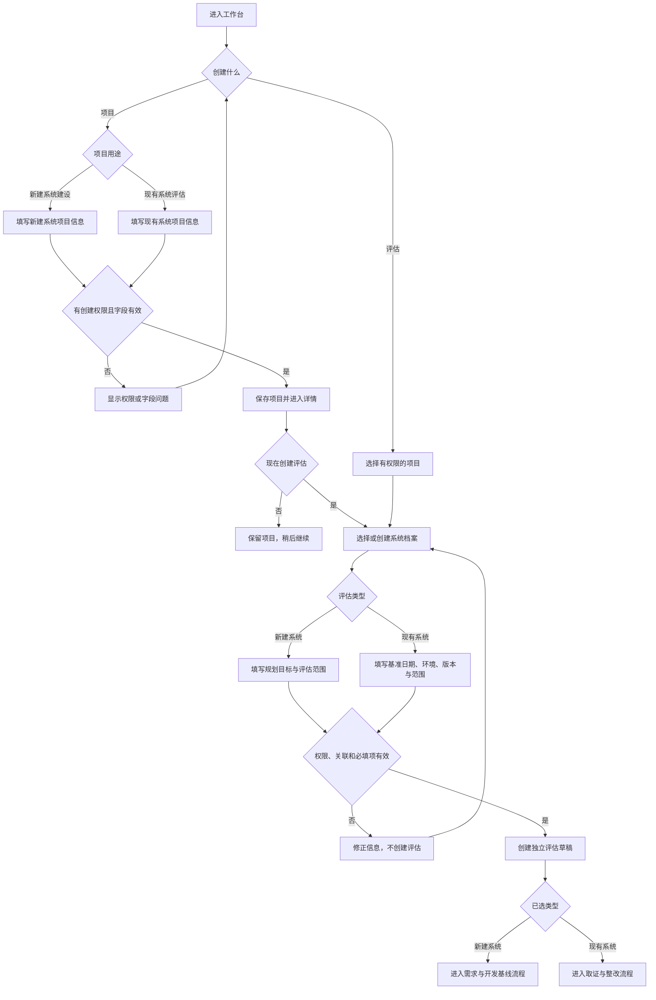
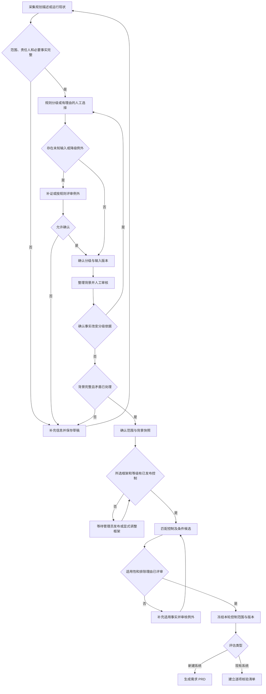
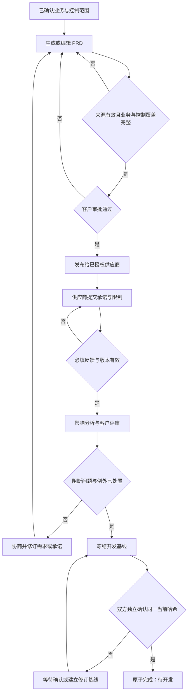
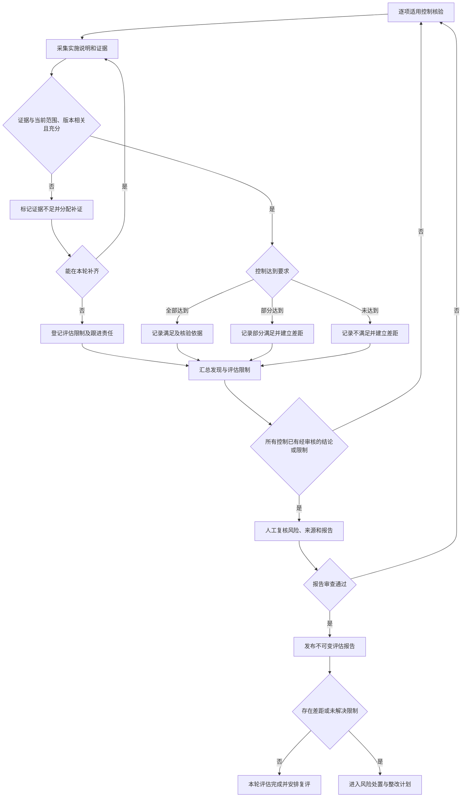
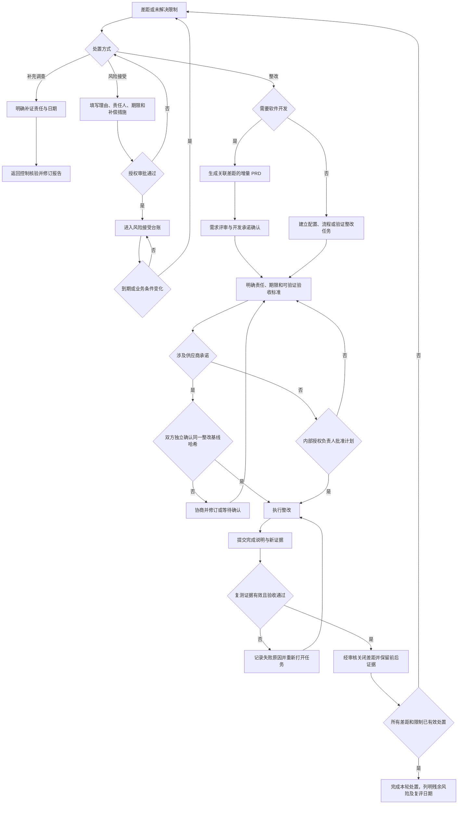
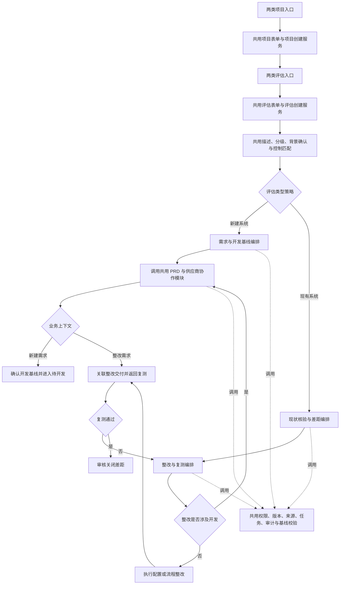

> 已移除创建关联后继评估入口及接口能力。历史关联保留，新建评估从台账发起。

# 新建与现有系统双流程更新方案

版本：v1.1  
日期：2026-11-01  
状态：产品更新方案及实施记录；核心双流程已实现，详见第 14 节。

## 1. 更新目标与现状

当前应用从业务描述、分级、背景确认、控制匹配，进入 PRD、供应商响应、影响分析及双方确认，最终形成 `PENDING_DEVELOPMENT` 待开发基线。

本次扩展保留该流程，增加现有系统的“现状取证—差距评审—整改—复测”闭环，并明确区分创建项目和创建评估的入口。

- 新建系统评估：回答应该建设什么，输出开发基线。
- 现有系统评估：回答实际做到了什么、缺少什么，输出评估结论、整改计划和复测记录。
- 现有系统中需要开发的整改项：关联增量 PRD 和已有供应商协作流程；不重新生成整个系统的建设需求。

本文依据 [README](../README.md)、[实施说明](implementation.md) 和 [开发规格](../development-specification.md)。以下新增状态、字段和行为均为拟议设计。

## 2. 项目、系统档案和评估的关系

| 对象 | 用途 | 生命周期 |
|---|---|---|
| 项目 | 承载组织归属、人员权限、任务管理和项目目标 | 可跨多次评估持续存在 |
| 系统档案 | 稳定标识被评估系统，保存负责人、业务身份和生命周期 | 从规划、建设到运行持续存在 |
| 评估 | 对特定范围、时间和版本开展的一轮工作 | 独立保存类型、状态、证据、结论和基线 |
| 整改任务 | 对一个或多个差距落实修复、验证和责任 | 与差距及原评估双向关联 |

建议第一版采用一个项目包含多个系统档案、一个系统档案包含多轮评估的关系。系统档案归属单一项目；跨项目共享不在第一版范围内。现有 `/systems` 相关记录不能直接假定为新模型中的档案，实施前需核实其实际评估语义，通过增量关联兼容。

项目用途决定创建评估时的默认选项，不永久限制未来评估类型。新建项目中的系统上线后，可以在原项目、原档案下启动现有系统评估，保留历史开发基线。

## 3. 创建入口与页面行为

### 3.1 创建项目

“项目与分配”页提供两个清晰入口：

| 入口 | 英文 | 默认用途 | 创建后行为 |
|---|---|---|---|
| 创建新建系统项目 | Create a new-system project | 新建系统建设 | 进入项目详情，可继续创建新建系统评估 |
| 创建现有系统评估项目 | Create an existing-system assessment project | 运行系统评估与整改 | 进入项目详情，可继续创建现有系统评估 |

共同字段包括项目名称、项目说明、负责人及人员分配。现有系统项目可补充现状评估目标和计划周期，但详细资产、证据在评估阶段填写。

创建项目不自动生成评估、调用模型、确认控制或创建空白 PRD。成功后展示“创建评估”操作；创建项目权限沿用当前管理员边界，不因新增入口而扩大权限。

### 3.2 创建评估

项目详情及评估台账均提供“新建系统评估 / New-system assessment”和“现有系统评估 / Existing-system assessment”。从台账进入时先选择有权限的项目，从项目详情进入时预填项目。

共同字段：项目、系统档案、评估名称、评估类型、负责人、范围说明。新建系统评估补充规划目标；现有系统评估补充评估基准日期、系统版本、部署环境和评估触发原因（首次、周期、重大变更、整改复评）。

已有档案应优先选择；确需新系统时显式创建档案。重名只提示检查，不自动合并。界面必须展示项目用途、系统生命周期和本次评估类型，避免混淆。

评估类型草稿阶段可显式调整，但已有类型专属数据时不得静默丢弃，需提示另建评估；首次范围确认后锁定类型，后续通过新评估关联原记录。选择与项目默认用途不同的类型需要说明原因，不阻断合法的生命周期转换。



### 3.3 台账与工作区

台账增加评估类型、系统档案、评估轮次、基准日期和处置状态筛选。项目状态不能替代评估状态。新建流程显示 PRD 与开发基线；现有流程显示控制核验、差距、整改、复测，不显示无关的必填 PRD 步骤。

现有系统概览分别显示已核验覆盖率、证据不足数、未关闭差距数、逾期整改数和风险接受数。未评估项和不适用项不得计为满足，风险接受不得计为修复通过。

## 4. 共用前置阶段与判断

两类评估复用分级、已发布控制库、控制适用性及来源管理。现有系统描述应区分实际事实和未来计划；历史 PRD 是设计来源，不自动证明当前实施情况。

内部风险等级反映业务影响，不等于控制落实程度，也不自动代表外部正式定级或认证。不得因安全措施不足而降低业务等级。



适用性分为适用、不适用和待确认。待确认不能自动当作不适用；必需控制排除保留现有例外审批要求。控制库升级须显式触发新版本评审，不静默替换已确认快照。

## 5. 新建系统流程：保留现有基线机制



生成失败、来源无效或结果过期时不得推进阶段。规则草稿与模型结果仍明确区分。待开发表示约定成立，不表示开发完成或系统安全达标。

## 6. 现有系统流程：取证、差距与报告

### 6.1 核验数据与结论

每条适用控制记录：核验范围、实施说明、证据引用、证据采集时间、对应环境与版本、核验方法、核验人、结论和理由。证据支持人工登记及受控引用；附件存储需单独设计权限及保留策略，不能在本方案阶段宣称已支持。

| 结论 | 含义 | 下一步 |
|---|---|---|
| 未评估 | 尚未进行核验 | 分配并执行核验 |
| 证据不足 | 无法支持可靠判断 | 补证；不得自动判定满足或不满足 |
| 满足 | 当前范围内有充分证据支持控制有效 | 纳入报告，保留验证边界 |
| 部分满足 | 部分范围或要求未达到 | 创建差距 |
| 不满足 | 有依据确认控制要求未达到 | 创建差距 |

不适用是适用性决定，不与实施结论混用。供应商自述与评估人员验证结果分开记录；AI 可提出分析建议，最终结论由有权限的人确认。



报告允许明确披露证据不足的局限，但不能给出无保留的满足结论。报告发布与整改完成分别记录；所有未评估项必须完成核验或转成经审核的具体限制，不能用空白记录通过报告审查。

报告至少包含评估对象、范围、基准日期、系统和控制库版本、方法、控制结论、证据索引、差距、风险依据、评估限制与审核记录。风险优先级由影响和可能性及现有措施综合判断，不直接复制系统等级；规则和人工调整理由须留痕。

## 7. 风险处置、整改与复测判断

差距项包含来源控制及证据、影响范围、风险与优先级、责任人、计划日期、验收标准和处置方式。处置方式可为整改、风险接受或补充调查；不可通过删除差距结束流程。



纯内部整改采用明确的内部审批路径，不虚构供应商身份。涉及供应商的开发或整改基线，仍必须由客户与独立供应商确认同一内容哈希。双方同意整改不代表复测通过。

“完成本轮处置”包括经批准且未到期的风险接受，但界面和报告必须标明残余风险，不称为全部修复。已接受风险到期后重新进入处置，历史报告保持不变，必要时启动后继评估。

## 8. 状态与回退规则

以下为业务阶段建议，实施时再映射到现有状态机，避免简单复用 `PENDING_DEVELOPMENT` 作为现有系统终态。

| 类别 | 建议阶段 |
|---|---|
| 共用 | 草稿、分级确认、背景确认、控制评审 |
| 新建专属 | PRD 评审、供应商响应、影响评审、开发基线确认、待开发 |
| 现有评估 | 现状核验、差距评审、报告已发布 |
| 现有处置 | 待计划确认、整改中、待复测、处置完成、存在已接受风险 |

评估阶段、任务状态和风险接受状态分别保存。整改逾期是日期派生标记，不能覆盖“待复测”等业务状态。

| 变化或异常 | 处理规则 |
|---|---|
| 业务范围或分级依据变化 | 创建后继修订，重新分级及背景确认，标记下游结论待复核 |
| 控制库升级 | 显式比对新增、变更和退出控制，重新评审受影响项 |
| 证据更新 | 保留旧证据；关联核验结论进入待复核，不覆盖历史报告 |
| 已确认计划内容变化 | 创建新基线；旧确认不适用于新哈希，双方重新确认 |
| 复测失败 | 任务重新打开，记录失败原因和下一次计划 |
| 后台模型任务失败或过期 | 不发布结论、不推进流程；允许显式重试或人工处理 |
| 周期到期或重大变更 | 创建关联原档案与基线的新评估，不重置旧评估 |

## 9. 角色、权限与双语界面

沿用组织隔离、项目授权、任务分配以及管理员和项目经理的既有权限边界。评估人、整改责任人、系统负责人先作为任务职责，不直接新增能够绕过现有授权的角色。

供应商仅访问明确分配的核验或整改任务及必要材料。客户组织内的管理权限不能替代供应商独立身份。普通操作人与审核人的贡献约束继续生效。

所有新增入口、阶段、错误、结论与报告框架同时提供中英文；切换语言保留用户撰写的名称、证据和结论。模型生成与规则草稿标识持续可见。

| 中文 | 英文 |
|---|---|
| 现状核验 | Current-state verification |
| 证据不足 | Insufficient evidence |
| 差距清单 | Gap register |
| 整改计划 | Remediation plan |
| 待复测 | Awaiting retest |
| 风险接受 | Risk acceptance |
| 处置完成（存在已接受风险） | Disposition complete — accepted risks remain |

## 10. 数据、版本与兼容要求

建议新增项目默认用途、系统档案关联、评估类型及轮次、评估范围快照、控制核验记录、证据元数据、差距、整改任务、风险接受记录、复测记录和整改基线。

所有结论引用明确的控制版本、系统范围版本和证据版本。增量 PRD 保留“原评估—差距—控制—需求—任务—复测”的来源链。并发修改继续使用版本检查，创建与确认命令保持幂等，后台任务发布前检查输入版本。

历史记录默认归为新建系统评估并保留原标识、状态、PRD 和确认哈希。新增分类元数据不得重新计算既有基线哈希。未关联项目的历史评估维持可读，提供显式关联，不自动扩大权限。

迁移仅新增字段、表及必要回填；数据库仍为 `.syseval/assessment.db`，除非明确配置覆盖。不得清空运行记录、备份、用户或控制库。迁移前备份，并在隔离副本验证；本文件交付不执行迁移。

## 11. 实施分期

开发顺序增加第 0 阶段：先完成第 13 节的共用能力盘点和最小必要抽取，再逐项实现两类流程。后续阶段必须调用共用模块，不能各自复制一套同义实现。

| 阶段 | 交付内容 | 完成条件 |
|---|---|---|
| 0：共用能力整理 | 建立复用清单、兼容测试，抽取必要的流程策略和基线校验 | 原新建流程行为不变，明确每项能力唯一实现位置 |
| A：入口与关联 | 区分项目和评估入口；档案、类型、轮次与台账 | 两类评估正确分流，历史流程不受影响 |
| B：现状评估 | 控制核验、证据引用、差距及报告 | 每个结论有依据或明确限制，报告可追溯 |
| C：整改闭环 | 计划审批、任务、风险接受与复测 | 完成声明不能跳过复测；接受风险不计为修复 |
| D：开发联动 | 差距生成增量 PRD、供应商基线与状态关联 | 开发完成后仍需回到原评估核验关闭 |

第一版不包括自动扫描、自动资产发现、未经确认的 AI 合规判定、外部认证结论或跨组织资产共享。可先登记外部验证证据，后续再设计集成。

## 12. 离线确定性验收

| 场景 | 预期行为 |
|---|---|
| 分别创建两类项目 | 保存正确默认用途，不自动创建评估或 PRD |
| 从项目或台账创建评估 | 关联正确项目和档案，校验组织、角色和任务权限 |
| 新建项目中的系统上线后发起现有评估 | 原档案增加评估轮次，历史开发基线不变 |
| 锁定后修改评估类型 | 拒绝原地切换，允许创建关联的新评估 |
| 无已发布控制库 | 可完成初筛，阻止控制匹配并提示发布条件 |
| 供应商称已实现但无证据 | 标记证据不足，不自动通过 |
| 证据对应其他环境或过期版本 | 要求补证或明确评估限制 |
| 未评估或不适用项进入统计 | 不计为满足，保留正确分母及适用范围 |
| 仅需配置整改 | 可直接建立整改任务，不强制生成 PRD |
| 开发型差距生成 PRD | 保留差距和控制来源，最终返回复测闭环 |
| 供应商基线仅一方确认或哈希不同 | 阻止确认完成 |
| 内部整改无供应商 | 按明确的内部审批路径处理 |
| 标记整改完成但未复测 | 保持待复测，不关闭差距 |
| 复测失败 | 重新打开任务，保留失败记录 |
| 风险接受批准、拒绝及到期 | 分别进入接受台账、返回处置、触发重新评审 |
| 证据不足报告发布 | 明确披露限制并生成跟进，不产生全部满足结论 |
| 旧任务结果返回或并发编辑 | 拒绝过期发布或返回版本冲突 |
| 越权读取证据或跨组织关联 | 拒绝访问或关联，不泄露受限内容 |
| 语言切换 | 界面翻译，用户撰写内容不变 |
| 历史数据迁移 | 原标识、状态、来源、基线哈希和独立确认保持有效 |

业务实现时新增隔离数据库与模拟模型的离线测试，并从项目根目录执行：

```powershell
uv run --project backend --extra dev python -m pytest evals/deterministic -q
uv run --project backend --extra dev ruff check backend/app backend/migrations evals run.py
npm --prefix frontend test
npm --prefix frontend run build
```

实施状态与边界见第 14 节；运行数据不因开发和测试被重置。

## 13. 共用能力评估与开发约束

### 13.1 评估结论

采用“共用前置流程和基础能力 + 两类业务流程编排”。入口区分不意味着页面、API、函数或数据模型必须复制两份。项目创建和评估创建仍是不同业务动作；同一动作的两类入口共用实现，以类型和字段配置表达差异。

可直接复用的主要是权限、分级规则、控制库与匹配、来源引用、任务执行、双语和通用交互；需要先抽取的主要是流程导航、版本失效处理、基线确认和报告基础能力；现状核验、整改与复测则新增独立业务规则。

现有代码中 `service.py` 的 `baseline_payload` 直接读取 PRD、供应商轮次和影响报告，`finalize` 固定进入 `PENDING_DEVELOPMENT`；`invalidate` 直接清空这些下游指针。因此它们不能原样套用于现有系统评估。应抽取共同校验及版本机制，保留各流程专属的载荷构造、失效依赖和完成条件。

### 13.2 流程与方法复用矩阵

| 能力 | 结论 | 现有实现依据 | 开发方式与差异边界 |
|---|---|---|---|
| 项目创建与人员分配 | 共用，增加默认用途 | `access.py`、`integration.py` 及项目管理界面 | 两个项目入口调用同一创建服务和表单；默认用途作为参数，沿用权限 |
| 评估创建与台账 | 共用，扩展类型字段 | `/systems`、`App.tsx` | 一个评估创建服务；不同类型校验必要扩展字段；项目创建与评估创建不可混为同一命令 |
| 描述采集和背景确认 | 共用主体、分类型验证 | `narrative.tsx`、`BriefReview.tsx`、`service.confirm_context` | 共用编辑、草稿、来源与确认机制；现有系统补充实际版本、环境和时间，区分事实与计划 |
| 分级与人工例外 | 复用现有规则入口 | `screening.py`、`service.confirm_classification` | 按已记录的方法版本选择规则；新流程不得复制分级算法，不把历史规则冒充当前规则 |
| 控制库和适用性匹配 | 共用 | `screening.match`、`service.match_profile_controls`、`ControlsPanel` | 共用发布快照、匹配、候选及排除评审；不建立第二个现有系统控制库 |
| 来源与证据引用 | 抽取共用引用校验，新增核验证据语义 | `domain.py` 来源校验与 PRD 导入来源记录 | 共用对象权限、版本和来源有效性；运行证据增加环境、时效、核验方法，设计来源不自动成为有效性证据 |
| 组织与任务权限 | 直接复用并扩展动作 | `access.capabilities`、`access.require_action` | 新动作纳入现有授权策略；不得在新页面或路由自写另一套组织授权规则 |
| AI 调用与后台任务 | 共用执行设施，新增任务契约 | `ai.py`、`worker.py`、`service.schedule`、`service.publish_job` | 共用配置、租约、重试、用量和过期检查；按任务类型注册输入、Schema、校验和发布逻辑 |
| PRD 与增量 PRD | 共用生成、审核和文档版本流程 | `domain.validate_prd`、`ai.render_prd`、`PrdPanel` | 增量 PRD 增加差距来源和变更范围；覆盖校验针对显式确认的增量范围，不要求重新覆盖整个旧系统 |
| 供应商参与 | 共用身份、分配与不可变提交机制 | `service.save_submission`、`SupplierPanel` | 开发承诺与现状取证使用不同响应契约；不得把“承诺实现”解释为“已验证实现” |
| 影响报告与现状报告 | 共用报告基础能力，保留不同判断规则 | `domain.validate_report`、`ImpactPanel` | 共用来源展示、版本、人工审核与导出基础；新增现状报告 Schema 和控制核验规则，不直接复用影响报告语义 |
| 基线、哈希与确认 | 抽取共同原语，分业务策略 | `domain.digest`、`service.freeze_baseline/confirm_baseline/finalize` | 共用规范序列化、当前版本检查和独立同哈希确认；载荷、审批参与方和终态由服务端策略确定 |
| 版本失效与审计 | 共用机制，分依赖关系 | `service.invalidate`、现有历史记录 | 共用修订和审计；新建失效 PRD 等，现有评估标记核验、报告、计划待复核，不能统一清空记录 |
| 工作区导航与通用 UI | 抽取配置后共用 | `Workspace.tsx`、`components.tsx`、`i18n.tsx` | 一个工作区外壳按类型提供步骤及面板；复用加载、错误、版本冲突、模型标识和历史记录 |
| 现状核验、差距和风险接受 | 新增专属业务模块 | 现有业务没有等价闭环 | 调用共用权限、证据、版本和审核能力，不复制基础设施 |
| 整改执行与复测关闭 | 新增专属业务模块 | 当前待开发终态不代表实际交付 | 独立验收规则；调用共用任务、来源和审批原语，复测失败和风险到期保留专属状态转换 |

### 13.3 建议的模块与函数边界

以下名称是职责建议，不是已存在的接口，也不要求为每个函数单独建文件。优先在现有模块中扩展；当两处真实调用需要共享时再抽取，避免先建设通用工作流平台。

| 模块职责 | 建议函数或契约 | 约束 |
|---|---|---|
| 创建服务 | `create_project(input)`、`create_assessment(input)` | 各自只有一份实现；类型字段驱动差异验证，命令保持幂等 |
| 流程策略 | `get_workflow_policy(assessment_type)` | 返回允许阶段、转换及业务校验器；未知类型拒绝处理，不默认跳入供应商阶段 |
| 来源校验 | `validate_source_refs(refs, scope)` | 校验存在、归属、可见性和版本；证据是否充分由核验规则决定 |
| 版本依赖 | `invalidate_dependents(change, policy)` | 按依赖标记受影响结果；保留旧版本，不无差别清空 |
| 基线共同校验 | `validate_current_baseline(...)`、`validate_confirmations(...)` | 共享哈希、新鲜度与独立身份检查；旧基线序列化协议保持兼容 |
| 基线业务适配 | `build_development_baseline(...)`、`build_remediation_baseline(...)` | 各自构造明确类型的载荷、验证完成条件；不伪造 PRD、供应商或报告填充空值 |
| 现状评估 | `validate_control_verification(...)`、`review_gap(...)` | 独立区分满足、部分满足、不满足和证据不足 |
| 整改闭环 | `approve_remediation_plan(...)`、`record_retest(...)`、`close_gap(...)` | 关闭必须满足复测规则；内部审批与供应商双确认路径由授权策略决定 |
| 前端共用表单及工作区 | `ProjectCreateForm`、`AssessmentCreateForm`、按类型的步骤配置 | 双入口传入默认类型；共用草稿及错误处理，专属字段和面板通过明确配置组合 |

业务命令负责事务边界，把权限、当前版本、业务校验、状态更新和审计作为原子操作。共用函数不能各自提前提交，导致后续失败留下半完成状态。

审批策略由后端根据基线类型、实际供应商责任及授权配置确定，客户端不能通过 `skip_supplier` 一类参数绕过双确认。现有开发基线仍执行原双确认规则。

### 13.4 共用模块调用关系



同一个 PRD 协作模块可以服务两种上下文，但它完成的是需求和承诺确认；整改实施、交付及复测由整改模块继续跟踪，不能由 PRD 通过事件直接关闭差距。

### 13.5 开发与评审必须遵守的规则

1. 每项开发先列出已有函数、调用方、复用方式及确需新增的业务差异，优先调用已有实现。
2. 禁止复制 `service.py`、`Workspace.tsx`、分级算法、控制匹配、权限检查或哈希确认代码，再改名作为第二条流程。
3. 把稳定相同的规则放在一个函数或模块中；差异集中到有类型的策略、数据契约或专属模块，避免散落大量类型判断。
4. 不为复用而合并不同含义的结论、放松验证、扩大权限或将所有字段设为可选；共用基础能力不等于共用所有业务状态。
5. 旧路由可以作为兼容入口委托给共用服务，不维护两份业务实现；前端隐藏按钮不能替代后端状态及授权检查。
6. 抽取与新增能力分步提交，先验证原流程行为等价，再接入现有系统分支；不趁机重写无关模块。

### 13.6 共用能力验收补充

| 验收项 | 预期结果 |
|---|---|
| 两类入口调用创建服务 | 共用字段及错误处理一致，类型专属必填规则分别有效 |
| 相同分级方法、版本与输入 | 两类评估得到相同推荐，不存在第二套分级算法 |
| 相同控制库、事实、框架与等级 | 两类评估得到相同匹配结果，差异仅来自显式输入 |
| 共用权限与版本异常 | 参数化测试覆盖两类评估的越权、冲突和过期发布 |
| 共用基线校验 | 开发及供应商整改基线均拒绝缺失确认、不同哈希和同人双方确认 |
| 内部整改策略 | 只有符合内部路径的任务可以内部批准，不能绕过已有供应商责任 |
| 抽取旧流程逻辑 | 原确定性回归通过，历史序列化与基线哈希保持不变 |
| 业务差异 | 开发承诺不成为核验结论，PRD 审批不关闭差距，复测失败不进入完成 |
| 实现审查 | 复用矩阵中的共同能力具有唯一规则实现；入口及兼容包装允许多个调用方 |

共用规则采用参数化测试覆盖两种上下文；专属规则保留各自测试，不机械复制整套测试文件。代码审查检查实际调用关系，不能只凭函数命名宣称已完成复用。

## 14. 实施结果（2026-11-01）

阶段 0、A、B、C、D 已接入应用并进行回归验证：

- 创建项目区分默认用途；两类评估使用同一创建服务和表单，支持系统档案、后继评估与台账筛选。
- 共用描述、分级、背景确认、控制匹配、权限、版本、任务及审计机制；基线共用校验已抽取。
- 现有流程提供证据登记、逐项核验、差距与风险评审、不可变报告及 Markdown 下载。
- 整改计划支持内部审批和独立供应商同哈希确认，修订清除旧确认；供应商可以提交实际交付证据。
- 完成提交进入待复测，失败返回整改，通过关闭差距；整改前证据不能用来证明完成。原报告和初始核验结论保持不变。
- 风险接受记录责任、理由、补偿措施及期限；到期显示重新处置，并在下一次有效命令中记录到期事件。
- 开发型整改关联增量评估，复用 PRD 和供应商开发基线流程，交付后返回原差距复测。
- 来源变更阻止过期结论继续推进；历史修订、报告、证据与原基线保留。

新增表通过 existing_assessments 增量迁移部署，本地自动建表模式在重启时创建缺失表。本次开发与测试使用隔离数据库，没有迁移、清空或重置实际运行数据。

当前证据支持文本及受控来源说明登记，不包含二进制附件上传或自动扫描。现状报告由人工审核发布；模型参与的增量 PRD 沿用既有生成与标识机制。内部风险优先级采用影响、可能性三级乘积：6–9 高、3–4 中、1–2 低，保留人工判断依据，不作为外部认证结论。

测试入口：evals/deterministic/test_existing_workflow.py、test_assessment_rules.py、test_baseline_rules.py；frontend/src/existing-assessment.test.tsx；frontend/evals/e2e/existing-assessment.spec.ts。部署与实际模块对应见 implementation.md。

### 最终验证记录

2026-11-01：后端确定性回归 278 项通过；前端 63 项通过；Ruff 通过；TypeScript/Vite 生产构建通过；Edge 浏览器端三条流程（控制库维护、新建系统双方基线、现有系统整改复测）全部通过。迁移测试验证旧基线原文、哈希、状态及独立确认不变。浏览器使用独立临时 SQLite 数据库及 8018 测试端口，验证后已停止本轮测试服务。测试不调用付费模型，不代表生产数据库已执行迁移或生产服务已重启。剩余提示为依赖弃用及前端包体积警告。
