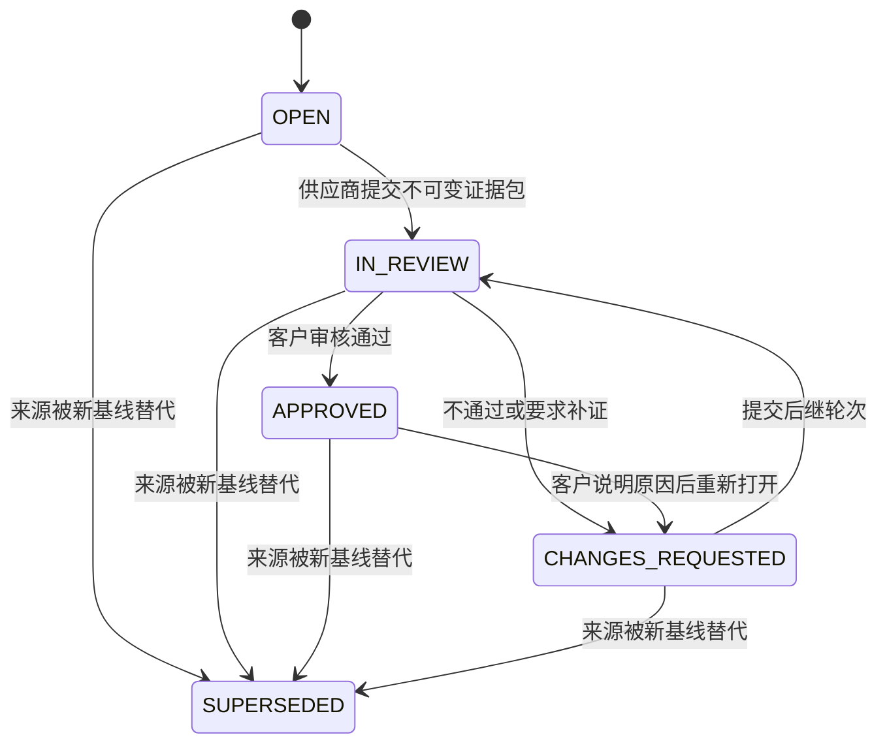

# Finding 交付证据与整改审核：技术开发方案

版本：v1.0；日期：2026-11-01。  
状态：首版人工交付链路已实现；实现差异与验证边界见第 15 节。尚未对运行数据库部署迁移。
适用：新建系统完成双方基线确认后的开发交付，以及现有系统评估后的供应商整改（remediation）。

## 1. 目标与范围

将“双方同意开发/整改范围”之后的过程延伸为：按评估 finding 建立交付项，供应商逐项上传截图或文件、提交完成说明，客户负责人或获授权经办人审核并给出通过、不通过或补证结论，保留每轮证据和审核历史。未来接入 AI 识别与评估时，复用同一份证据、来源及版本链。

首版包含真实附件上传与受控下载、逐项提交、多轮补证、人工审核、整改复测衔接、进度汇总、审计、权限隔离和增量迁移。不包含项目排期、人力资源安排、工时管理、CI/CD 发布、自动扫描系统或 AI 自动批准。文件格式和容量采用本文默认值，可经配置调整；这些是设计值，不是已有系统能力或已测性能。

**业务边界：** 双方确认说明同意范围和承诺，供应商提交说明声称已完成，人工审核通过说明该交付项证据符合验收条件；现有系统的原差距只有在客户复测通过后才能关闭。风险接受始终区别于修复通过。

## 2. 当前实现与扩展位置

本设计以规范目录 `A:\SysEvalAuto-v0.0.1` 为准，参考 [README](../README.md)、[实现说明](implementation.md)、[开发规格](../development-specification.md) 和 [双流程说明](existing-system-assessment-update.md)。当前工作区已有双流程改动；实现本功能时应在其上增量扩展，不覆盖这些改动。

| 当前实现 | 已有能力 | 本次需要增加 |
|---|---|---|
| `backend/app/service.py`：`baseline_payload`、`finalize` | 冻结 PRD、供应商回答、影响报告及决策；双方确认后到 `PENDING_DEVELOPMENT` | 以已完成基线初始化交付工作区；原基线 payload/hash 不变 |
| `backend/app/domain.py`：`Finding`、`validate_report` | finding 关联 requirement，引用供应商回答字段；finding 存在报告 JSON 内 | 建立可逐条操作、可查询的交付项，保留报告内 finding 身份 |
| `backend/app/existing_service.py` | 现状核验、报告、gap、计划确认、完成提交、复测、风险接受 | 附件证据、逐 gap 审核、与计划级完成/复测联动 |
| `CurrentAssessment.data`、`AssessmentEvidence` | 计划/gap/report JSON；不可变文本证据登记 | 新增附件实体与提交记录；不把历史文本描述伪装成已上传文件 |
| `existing_routes.py`：`supplier-remediations` | 指定供应商确认计划并提交文本交付证据 | 保留入口，委托共同服务，避免新旧接口绕过逐项审核 |
| `access.py` | 组织、项目、任务权限；普通审核者贡献约束 | 单独定义交付审核动作，允许任务经办人审核供应商成果 |
| `worker.py`、`ai.py`、`ai_settings.py` | 持久任务、租约、fencing、模型设置、来源校验及用量 | 后续增加文件提取/视觉评估任务类型与发布校验 |
| `Workspace.tsx`、`ExistingAssessment.tsx`、`downstream.tsx` | 两类评估工作区、供应商及基线界面 | 共用交付列表、证据组件、审核面板和双语状态 |

现有 `existing_service.retest` 按计划执行，通过后关闭该计划关联的全部 gap。因此首版保留“逐项交付审核 + 计划级复测”的两层模型；不得把某一个 finding 的审核通过直接映射为整份计划关闭。

## 3. 核心业务模型与来源映射

### 3.1 三种接入场景

| 场景 | 启动前提 | 来源与完成含义 |
|---|---|---|
| 新建系统开发 | 当前 `Baseline.finalized=true`，已满足既有双方同哈希独立确认 | 从该基线快照里的报告 findings 初始化；全部必需交付项通过后，可记录“本批交付审核完成” |
| 现有系统直接整改 | 当前计划 `in_progress`；涉及供应商时已有双方对同一计划 hash 的确认 | 从计划引用的已审核报告 gap 初始化；逐项通过后进入计划级待复测 |
| 现有系统开发型整改 | 已批准整改计划及其关联增量开发评估；提交前须完成子评估开发基线 | 原计划 gap 为主交付项；子评估 finding 作为关联要求；交付后回到原计划复测 |

开发型整改在计划已批准后可以建立工作区并准备草稿，但正式提交必须同时绑定有效的 `plan_hash` 和已完成的 `development_baseline_hash`。子评估入口跳转同一交付工作区，不能自动再建一套重复整改任务。

### 3.2 Finding 的稳定身份

- 新建系统：`source_kind=impact_finding`，身份为 `system_id + assessment_revision + report_id + finding_id`；从 baseline payload 读取，不从可能已经变化的当前报告读取。
- 现有系统：`source_kind=assessment_gap`，身份为 `system_id + assessment_revision + report_id + gap_id`。当前 gap ID 取自 control ID，不能只用 control ID 跨评估或修订关联。
- 每个交付项存原始 finding/gap、需求、控制及验收条件快照与来源 hash，独立保存交付状态；不修改原评估结论和风险等级。
- 默认逐条导入全部来源 finding/计划 gap，包括未知风险和供应商原答复为 yes 的条目；“承诺可以实现”不等于已经交付，不能按风险筛选遗漏。
- 同一控制关联多个 finding 时保持独立条目；允许共用文件，但每项必须单独说明该文件证明了哪项验收条件。
- 无 findings 时展示“无来源项，待核对”，不能把 0/0 自动当作全部通过。负责人可以记录有理由的“无需交付项”处置；它不产生修复通过结论，也不绕过现有计划规则。

### 3.3 验收要求与范围变更

默认验收条件取自冻结的 PRD `acceptance_criteria` 或整改计划验收条件。现有计划条件为计划级列表时，应显式建立 gap 到条件的映射；映射未完成或条件为空时允许暂存证据，不允许正式提交。

交付项不提供随意删除或随意设置“不适用”的按钮。调整验收义务、增加/撤销 finding、变更供应商责任或环境范围，必须走对应的基线/计划修订和重新确认；交付工作区只记录该变化及后继关联。仅内部备注或审核意见不重新触发双方确认。

已接受风险显示原决策及有效期，不自动标为审核通过。只有来源基线/计划明确记录“不要求本轮修复”的条目可进入 `EXEMPT`，并保留理由、批准人及来源；否则仍需交付。现有风险接受与已分配计划的互斥规则继续生效，不能通过新接口绕过。

## 4. 状态机与关闭条件

### 4.1 交付工作区

新增 `DeliveryBatch.status = ACTIVE | REVIEW_COMPLETE | SUPERSEDED`，与 `System.status` 分开。首版保留新建系统原 `PENDING_DEVELOPMENT` 状态和已完成基线，前端额外显示“交付执行中/交付审核完成”。这避免破坏当前开发型整改对 `PENDING_DEVELOPMENT` 的检查；交付审核完成不表示部署上线或整个系统安全认证通过。

`REVIEW_COMPLETE` 由客户显式完成命令产生：批次非过期、所有必需项最新有效审核为通过、没有待审提交/重开项、所有例外均有有效来源。现有系统批次完成只触发计划 `awaiting_retest`，原评估最终完成仍调用现有 `finalize` 规则。

### 4.2 交付项



`EXEMPT` 是依据有效来源产生的独立处置，不属于上图审核通过路径。风险到期后需要重新处置，不能继续计入有效豁免。草稿存在与否为独立字段，不把保存草稿误记为正式提交。

| 命令 | 前置条件 | 原子结果 |
|---|---|---|
| 保存证据草稿 | `OPEN/CHANGES_REQUESTED`；当前供应商授权有效 | 更新草稿版本，交付状态不推进 |
| 提交 | 当前来源有效、验收映射完整、至少一个可用附件、必要字段完整 | 冻结第 N 轮提交和附件清单，置 `IN_REVIEW` |
| 通过 | 当前轮待审；审核者有权限；逐条件检查完整 | 追加 `PASS` 决定，置 `APPROVED` |
| 不通过/补证 | 当前轮待审；原因必填 | 追加 `FAIL/NEEDS_MORE_EVIDENCE`，置 `CHANGES_REQUESTED` |
| 再提交 | 已被退回；上一轮不可变 | 新增第 N+1 轮，不覆盖旧文件、旧说明或旧审核 |
| 重开 | 当前已通过；客户授权及原因 | 追加重开事件，撤销其当前有效通过资格；批次回到 `ACTIVE` |
| 完成批次 | 所有必需项通过及例外有效 | 批次 `REVIEW_COMPLETE`；按场景触发后续动作 |

同一交付项同时最多一轮待审核。不允许供应商在审核期间替换附件或覆盖提交；首版不实现撤回待审包，需由客户退回后补交。后续发现错误的审核记录通过重开和新决定修正，不直接编辑旧决定。

### 4.3 与现有整改复测衔接

1. 每个计划对应一份交付批次，每个 gap 一项。一个计划多个 gap 时，部分通过只能显示部分完成。
2. 全部必需项通过后，桥接服务冻结本轮逐项结果及证据清单，并调用计划完成校验进入 `awaiting_retest`；在同一事务中保存批次完成、计划变更和审计。
3. 将附件关联为 `AssessmentEvidence` 的不可变引用，保留环境、系统版本、采集日期；计划完成仍执行批准后证据时效和开发基线检查。
4. 客户复测须记录实际复测依据、环境、目标版本、逐项结果及总体理由。原交付证据可作为输入，但不能用“交付审核已通过”替代复测结果。
5. 首版复测仍为计划级原子关闭：全部关联 gap 的复测通过才能关闭整个计划。失败时计划回到整改，失败/证据不足项转 `CHANGES_REQUESTED`，其他已通过项保留历史；环境或版本整体变化时全部受影响项重开。
6. 已关闭计划后发现新问题，走现有 reopen/后继评估规则；不能只打开子交付项而让父计划继续保持关闭。跨父子状态的操作必须一并校验并提交。

## 5. 权限契约

“负责人”映射为当前组织管理员或本项目 manager；普通经办人为当前任务 `Assignment.operator_id`。职责名称不新增全局超级权限。

| 操作 | 管理员/项目负责人 | 任务经办人 | 已分配且具有效 review 能力的审核人 | 供应商 | viewer |
|---|---|---|---|---|---|
| 查看本权限范围交付项和文件 | 是 | 是 | 是 | 仅明确分配的项/材料 | 只读 |
| 初始化/修订来源/分配供应商 | 是 | 否 | 否 | 否 | 否 |
| 上传、保存并提交供应商成果 | 否 | 否 | 否 | 是 | 否 |
| 审核通过/不通过/补证 | 是 | 是 | 是 | 否 | 否 |
| 重开、完成交付批次 | 是 | 是 | 是 | 否 | 否 |
| 改基线、风险接受、最终复测 | 沿用原有动作授权 | 不因交付审核新增这些权限 | 沿用原有动作授权 | 否 | 否 |

在 `access.py` 增加独立的 `delivery.review` 等动作策略：客户组织相同，并具 `manage`、有效 `review`，或当前任务 operator 身份之一。不能把经办人全局加入旧 `REVIEW_ACTIONS`，不能取消原 PRD、评估报告和基线的贡献/职责分离约束。经办人曾编写原需求不阻止其审核独立供应商的交付；审核者不能是本提交的提交人。

原系统内部整改继续使用现有路径；未来如允许客户代供应商上传，须另设“代录”权限与来源标签，并排除代录人自审，首版不做隐式代录。

供应商访问同时检查账号有效、供应商组织、项目角色是否撤销及具体交付项分配。新建系统可从原供应商组织沿用访问资格，但必须生成显式批次分配；现有计划沿用指定 supplier 用户，不扩大为供应商全组织自动可见。历史邀请式供应商继续使用既有合法授权路径，不强迫伪造 managed supplier 关系。

附件列表、预览、下载、历史提交、AI 结果都复用对象级授权。只知道文件 ID、SHA-256 或历史链接不构成授权。撤销项目访问后，旧链接和幂等重试也须先重新检查权限。对不可见对象返回 404，对可见但禁止的动作返回 403。

## 6. 持久化设计

### 6.1 新增实体（建议名称）

以下为新表设计，不表示当前 `db.py` 已有这些实体。归属字段统一为客户 `org_id`，供应商身份另外记录；外键及服务端联合归属校验必须覆盖所有跨对象关联。

| 实体 | 核心字段与约束 |
|---|---|
| `delivery_batches` | `id, org_id, system_id, assessment_revision, source_kind, source_id, source_hash, source_snapshot, status, version, created_by/at`；开发型额外绑定子基线；来源身份+hash 唯一，防重复初始化 |
| `delivery_items` | `id, batch_id, source_finding_id, source_report_id, source_snapshot, source_hash, acceptance_criteria, supplier_org_id, supplier_user_id?, status, current_submission_id?, version`；批次+完整来源身份唯一 |
| `delivery_drafts` | `item_id` 唯一；`description, environment, system_version, implemented_at, criteria_evidence_map, attachment_ids, version, updated_by/at`；不得更新已提交包 |
| `evidence_attachments` | `id, org_id, batch_id, item_id, uploaded_by, original_filename, detected_mime, size_bytes, sha256, blob_id, environment, system_version, collected_at, description, availability, created_at`；内容及业务元数据上传完成后不可改 |
| `evidence_blobs` | `id, org_id, content`（SQLAlchemy `LargeBinary`）、`sha256, size_bytes`；首版不做跨组织去重，不返回重复存在性信息 |
| `delivery_submissions` | `id, item_id, round_no, source_hash, acceptance_hash, payload, manifest_hash, submitted_by/at`；`item_id+round_no` 唯一；冻结后不可改 |
| `delivery_submission_attachments` | `submission_id, attachment_id, sha256, evidence_locator/criterion_id`；保证查询及引用完整性，提交保留精确清单 |
| `delivery_reviews` | `id, submission_id, submission_hash, decision, criteria_results, reason, reviewer_id, reviewed_at, mode=manual, ai_result_id?, source_hash`；每轮一个正式审核决定，纠正走后继轮次 |
| `delivery_events` 或既有 Audit | 批次/项/提交引用、动作、操作者、前后版本和状态、request_id、时间；与业务写入同事务 |
| `evidence_analysis_results`（后续 AI 阶段） | `job_id, submission_id, input_hash, schema_version, mode, model_snapshot, result, created_at, stale`；独立于人工决定 |

补充索引：批次 `org_id/system_id/status`；交付项 `batch_id/status` 和供应商分配；提交 `item_id/round_no`；审核 `submission_id`；附件 `item_id/created_at`。待审唯一性由交付项指针与条件更新保护，不能只靠前端禁用按钮。

现有 `CurrentAssessment.data` 暂保留计划及 gap 状态，新增表为逐项交付记录的唯一事实来源。桥接字段只存 `delivery_batch_id`、聚合提交引用及结果快照；两边不得各自维护一套可编辑证据包。`AssessmentEvidence` 保留已有格式，并通过新的关联表或可选引用指向附件证据，旧记录无需重写。

### 6.2 哈希与不可变边界

区分三类 hash：原基线/计划 `source_hash`、原文件字节 `sha256`、提交清单 `manifest_hash`。文件 hash 只能证明内容未变，不能证明截图真实性或修复有效。

提交清单采用现有 `domain.digest` 的规范序列化并记录 schema 版本，至少包括：来源类型/ID/hash、交付项 ID、验收条件 hash、说明、环境、系统版本、实施日期、按稳定顺序排列的附件 ID/hash/采集时间/条件映射。审核绑定 `submission_id + manifest_hash + source_hash`，不能只绑定交付项 ID。

增加附件、修正元数据或更改说明均生成新草稿/后继提交。已确认的原 baseline payload 和 content_hash 不纳入后续交付数据，不重新计算历史双方确认。

## 7. 附件上传、存储与展示

### 7.1 首版存储决定

遵守本项目“运行数据 exclusively `.syseval/assessment.db`，除非显式覆盖”的约束：附件元数据及二进制正文均存入当前配置数据库；SQLite 使用 BLOB，已显式配置 PostgreSQL 的部署使用对应二进制字段。不默认新增 `.syseval/uploads`、第二数据库或对象存储。未来如迁移对象存储，须作为明确的存储配置变更，定义搬迁校验和备份恢复方案。

文件先在限额内读取与校验，再短事务写入正文、元数据和审计；不在接收慢上传期间持有数据库写锁。应用上传解析不得把文件自动持久化到默认临时目录；采用有上限的内存缓冲和并发控制，并检查框架 multipart 临时文件行为。失败不留下可引用的半文件。更大附件和断点续传为后续能力。

### 7.2 默认限制与处理

| 项目 | 默认设计 |
|---|---|
| 允许格式 | PNG/JPEG/WebP 截图，PDF、DOCX、XLSX、TXT、CSV、Markdown 文件 |
| 单文件/单提交 | 单文件最大 20 MiB；每轮最多 10 个，总计不超过 100 MiB；正文说明最大 8,000 字符 |
| 配额 | 每个评估附件正文累计默认 1 GiB；计入历史提交和未清理草稿；组织级配额由服务端配置 |
| 文件限制 | 拒绝空文件、可执行文件、脚本、HTML/SVG、宏文档、加密文档及通用压缩包；DOCX/XLSX 容器须限制解压大小/条目数并拒绝宏及外部关系 |
| 格式识别 | 后端检查扩展名、声明 MIME、实际签名/结构一致性；不能只信浏览器 `Content-Type` |
| 截图 | 解码限制像素数与资源消耗；原件不可变；预览只使用安全解码后生成的栅格图，不把原字节当 HTML |
| 文档预览 | 首版 Office/PDF 只提供下载与元数据，避免未经隔离的主动内容执行；文本转义展示，Markdown 禁止原始 HTML 和远程资源 |
| 下载 | 鉴权接口输出 `Content-Disposition: attachment`、安全编码文件名、`nosniff` 和私有/不缓存策略；禁止静态公开路径 |

扩展名/结构检查不等于恶意文件扫描，界面不得声称“已安全扫描”。预留 `availability=AVAILABLE | QUARANTINED | REJECTED`；接入扫描器时，未完成或扫描失败的文件不能成为正式提交证据。首版未启用扫描时记录 `scan_status=NOT_CONFIGURED`，可用性只代表通过本地格式检查。

上传接口在接收业务文件前检查会话、CSRF、可见性和上传权限；流式计数执行限制，不能仅信 Content-Length。限制每用户并发上传及速率；配额使用数据库原子预留/更新，避免并发超额。文件名只作显示，不作为路径；不接受远程 URL 代替上传，也不由服务器自动抓取外链。

允许从草稿移除附件引用，但不物理删除已提交、审核或审计引用文件。未引用附件可按配置宽限期清理，提交与清理必须加锁复核引用；默认先禁用自动物理清理。数据库备份必须包含所有附件；SQLite 用一致性备份机制而非运行中只复制主文件，恢复后抽样核对附件 hash 和引用链。

## 8. API 契约

路径均以 `/api/v1` 为前缀，下表为拟新增接口。保留当前命令的 `version` 命名，不照搬旧规格中的 `lock_version`。

| 方法与路径 | 作用及关键参数 |
|---|---|
| `POST /systems/{id}/delivery-batches` | 管理动作初始化；`version` 为 System 版本，传来源类型/ID/hash；响应批次与项 |
| `GET /systems/{id}/delivery-batches` | 授权批次列表及聚合统计，分页 |
| `GET /delivery-batches/{id}` | 当前来源、版本、完成条件、客户可见统计 |
| `GET /delivery-batches/{id}/items` | `status/severity/query/cursor/limit`；分页必须在权限过滤后执行 |
| `GET /delivery-items/{id}` | 来源、条件、当前状态、草稿、提交历史、可执行动作 |
| `PUT /delivery-items/{id}/draft` | 保存说明与附件映射；`version` 为 item 版本，另传 `draft_version` |
| `POST /delivery-items/{id}/attachments` | multipart 文件和元数据；响应 `attachment_id/sha256/availability`，不自动提交 |
| `GET /evidence-attachments/{id}` | 鉴权元数据，不返回数据库正文 |
| `GET /evidence-attachments/{id}/content` | 鉴权下载原件；受控截图预览另用 `/preview` |
| `POST /delivery-items/{id}/submissions` | 提交当前草稿；`version, draft_version, expected_source_hash` |
| `POST /delivery-submissions/{id}/reviews` | `version` 为 item 版本；`submission_hash, source_hash, decision, criteria_results, reason` |
| `POST /delivery-items/{id}/reopen` | 客户重开；`version, reason`；检查父计划是否允许 |
| `POST /delivery-batches/{id}/complete` | `version` 为批次版本；原子校验所有项及父计划版本并完成 |
| `GET /delivery-batches/{id}/history` | 分页审计与历史引用，不包含文件正文 |
| `POST /delivery-submissions/{id}/analysis-jobs` | 后续 AI 阶段；显式调用，返回 202/job_id |

上传和初始化返回 201，普通同步命令返回 200；幂等重放返回最初响应。列表返回服务端 `allowed_actions` 供 UI 展示，但每个写接口仍需再次授权。

示例审核请求：

```json
{
  "version": 7,
  "submission_hash": "<当前不可变提交的 SHA-256>",
  "source_hash": "<当前已确认来源的 hash>",
  "decision": "PASS",
  "criteria_results": [
    {"criterion_id": "AC-01", "result": "PASS", "attachment_ids": ["att-01"], "comment": "截图和测试输出覆盖允许与拒绝场景"}
  ],
  "reason": "已核对目标环境及版本，验收条件全部满足"
}
```

`decision` 允许 `PASS/FAIL/NEEDS_MORE_EVIDENCE`，所有结论须说明依据。`PASS` 必须覆盖全部必需条件、各条件为 PASS，引用附件必须属于该轮提交。引用不到文件或条件失败时不能总体通过。

错误沿用现有 `DomainError` 与 HTTP 边界，新增稳定业务码并提供中英文：`SOURCE_SUPERSEDED`、`EVIDENCE_REQUIRED`、`EVIDENCE_NOT_AVAILABLE`、`EVIDENCE_SCOPE_MISMATCH`、`SUBMISSION_ALREADY_REVIEWED`、`DELIVERY_ITEMS_PENDING`、`UPLOAD_LIMIT_EXCEEDED` 等。401 未登录，403 禁止，404 不可见，409 状态/版本/幂等冲突，413 大小超限，415 格式不支持，422 字段错误。返回可定位字段或未完成项 ID，不在错误中泄露其他组织内容。

## 9. 事务、并发与来源变化

- 所有变更接受 `Idempotency-Key`，作用域为 actor/resource/action；相同 key 和请求 hash 返回原结果，不同请求返回 409。重放之前重新检查现时授权。
- 上传请求 hash 包含文件字节 hash 与元数据，失败重试不能产生重复附件。预检查授权，限额读取并校验后再查/写幂等收据。
- 逐项命令使用 item/version 条件更新，草稿额外检查 draft/version。每次有效项状态变更同步增加 batch.version，避免完成批次与重开项竞态。
- SQLite 不依赖 `SELECT FOR UPDATE` 生效，采用条件更新和受控写事务；PostgreSQL 可配合行锁。受影响行数不为 1 时冲突回滚；不将无条件最后写入当作成功。
- 审核事务依次验证来源、批次/项版本、当前待审提交、审核权限、条件覆盖；插入决定、更新状态、递增版本、写审计和 Receipt 一起提交。并发审核只能一条成功。
- 批次完成锁定批次、项及相关父计划/System，使用统一锁顺序；重新计算有效项集合。桥接服务不能自行提前 commit，任何一步失败均回滚。
- 来源修订时，旧批次 `SUPERSEDED`；后继批次显式创建并记录 `predecessor_id`。历史内容保持可查；即使正文相同，也不静默继承通过结论。
- 旧证据允许作为后继草稿的历史参考，但正式新证据必须满足当前环境、目标版本和时效；整改仍检查证据登记及采集时间不早于计划批准。
- 查询和命令均动态校验当前来源，避免只等失效任务运行才阻止旧提交。后台失败不能放行过期审核。
- 审计记录上传、提交、审核、重开、来源失效、批次完成、下载和后续 AI 调用；不在日志中记录二进制、密钥或完整敏感正文。

## 10. 前端工作区与双语

基线完成页增加“进入交付跟踪 / Open delivery tracking”；现有计划增加同一入口。供应商待办同时列出开发交付项和整改项，显示来源类型、版本和被退回原因，点击直接定位条目。

交付页使用列表和详情面板：上方显示来源基线与批次状态；列表按 finding 展示标题、控制/需求、风险、供应商、最新轮次及状态；详情并列显示原 finding、冻结验收条件、供应商说明、附件和人工审核。截图支持缩略图/放大，文件显示格式、大小、采集时间、环境及版本。

供应商可以逐条暂存并分批提交；上传成功不是提交成功。离开页面提示未保存草稿；网络失败保留输入和可重试项；409 保留本地文本并提示重新加载差异，不自动覆盖服务端。审核面板打开时固定提交 hash，发现轮次变化后必须刷新再审核。

审核结果、当前进度和原评估风险分别展示。统计分为“必需项通过 X/Y、待审、待补证、有效例外、来源已替代”；例外不计入通过率分子或必需项分母，另行显示。筛选不改变总体分母；供应商统计只计算其可见项。计划复测未完成时明确显示“交付审核已完成，待客户复测”。

| 中文 | 英文 |
|---|---|
| 交付证据 / 交付审核 | Delivery evidence / Delivery review |
| 待提交 / 待审核 | Awaiting submission / Awaiting review |
| 需补证 / 不通过 / 通过 | More evidence required / Failed / Passed |
| 人工审核结论 | Human review decision |
| 来源已更新，需重新提交 | Source superseded; resubmission required |
| AI 辅助意见（非最终结论） | AI assistance (not a final decision) |

使用现有 `i18n.tsx`、错误处理和通用组件。切换语言只改变 UI 和报告框架，不翻译或覆盖 finding、文件名、说明、审核意见等 authored text。文件上传、预览、表单校验均可键盘操作并标明保存/错误状态。

## 11. AI 识别与评估扩展契约

首版无需执行 AI 或安装 OCR 组件；先固定附件、提交、来源及审核的契约。将来接入两类独立任务：`evidence_extraction` 提取文本/表格/图像定位，`delivery_evidence_assessment` 根据 finding 与验收条件评估证据。它们不得替代已有的供应商承诺影响分析。

### 11.1 输入与输出

AI 输入只含授权当前提交、来源快照、逐条验收条件和必要附件，不发送整个组织资料。固定 `submission_id/manifest_hash/source_hash/acceptance_hash`、文件 hashes、提取器版本、提示词/Schema 版本以及非秘密模型配置快照。

提取结果定位到 `attachment_id + sha256 + page/line/sheet/cell/bounding_box`，保留无法读取、截断及提取失败状态。派生内容同样存现有数据库并保留原件引用；不得覆盖原图或伪造原文。

结构化评估结果至少包括：

```json
{
  "schema_version": "delivery-evidence-assessment/1",
  "submission_id": "sub-01",
  "input_hash": "<冻结输入 hash>",
  "mode": "model",
  "recommendation": "insufficient_evidence",
  "criteria": [
    {
      "criterion_id": "AC-01",
      "result": "insufficient_evidence",
      "reason": "截图未展示拒绝越权请求的结果",
      "citations": [{"attachment_id": "att-01", "sha256": "<文件 hash>", "page": 1}],
      "missing_evidence": ["目标版本下的越权拒绝测试输出"]
    }
  ],
  "limitations": ["静态截图不能单独证明生产环境持续有效"]
}
```

建议枚举为 `likely_pass/likely_fail/insufficient_evidence`，与人工 `PASS/FAIL` 分开。服务器验证条件覆盖、附件归属和 hash、定位有效性、引用文本与提取结果一致性；视觉推断明确标记为推断，不能声称机器验证了截图真实性。置信度即使提供也不直接驱动状态。

### 11.2 执行与发布

沿用现有 job/worker 的租约、fencing、超时、有限重试、用量和组织配置。模型调用前显式选择提交并确认必要的数据发送范围；文件不通过公开 URL 暴露给模型。模型能力是否支持相关格式，在接入阶段验证，不在本设计硬编码供应商型号。

文件、OCR 文本和截图中的指令均作为不可信材料，不获得工具或业务操作权限。模型失败、拒绝、截断、无法读取或引文无效时，记录失败/证据不足，人工路径仍可使用；不得悄悄回退成规则结果并标为 AI。

发布前重新核对输入 hash、当前提交/来源及任务 fencing。来源替代、任务失权或提交不再当前时只保留 stale 历史，不覆盖现时建议。每个输入 hash+配置版本的显式请求可幂等复用，用户显式重跑才创建新尝试。

AI 结果写独立表，不能写 `delivery_reviews` 的人工结论、不能关闭 gap、不能完成批次。人工审核可引用 `ai_result_id` 并记录采纳/不采纳理由。未来若要求自动审核，需另行增加决策策略版本、适用范围、人工复核/申诉与质量验收；本次数据模型不预先默认开启。

## 12. 代码组织与复用要求

| 模块 | 开发职责 |
|---|---|
| 新增 `backend/app/delivery_service.py` | 批次初始化、逐项提交/审核/重开/完成；单一业务写入口 |
| 新增 `backend/app/delivery_rules.py` | 纯规则：状态转换、条件覆盖、manifest、完成谓词；方便确定性测试 |
| 新增 `backend/app/evidence_service.py` | 附件验证、受控读取、配额及证据引用；两类流程共用 |
| 新增 `backend/app/delivery_routes.py` | 请求模型、路由、CSRF/会话与命令适配，无重复业务判断 |
| 扩展 `db.py` 与新增 migration | 上述表、约束、索引；不删除或改写旧基线 |
| 扩展 `access.py` | 动作级授权和供应商逐项访问；复用现有组织/项目能力 |
| 扩展 `existing_service.py` / `existing_routes.py` | 计划到交付适配、复测桥接、旧提交接口兼容；不复制第二套审核逻辑 |
| 扩展 `service.py` / `workflow_policy.py` | 暴露交付入口及来源关系；原 finalize 保持旧基线语义 |
| 新增 `DeliveryWorkspace.tsx`、`EvidenceUploader.tsx`、`deliveryTypes.ts` | 共用列表、上传、审核及历史；现有两类工作区挂接 |
| 后续扩展 `worker.py`、`ai.py`、`ai_settings.py` | AI 新任务、提取/评估适配、输入快照与结果校验 |

复用 `domain.digest`、基线校验原语、会话/CSRF、幂等收据及审计。不要复制整份 `service.py` 或两份页面分别服务新建/现有系统。现有 System 级 command 不能直接当作 item 级版本锁；复用其鉴权/收据/审计机制，明确 aggregate version 与事务拥有者。所有应用依赖只进入 `backend/pyproject.toml`、`frontend/package.json` 及各自锁文件。

## 13. 兼容、迁移与交付顺序

1. **规则与兼容基线：** 固定原工作流回归；定义来源适配与权限矩阵，确认新建/直接整改/开发整改三种路径。
2. **增量持久化和附件：** 新 migration 依赖 `existing_assessments` 之后实际迁移 head，新增表及索引。部署显式执行 migration，不依赖 `create_all` 修改已有表。先在隔离副本验证。
3. **逐项人工闭环：** 接入批次、草稿、提交、审核、重开、状态聚合及双语页面。此阶段即可满足新建系统供应商证据审核。
4. **整改桥接：** 接入原计划完成/复测，覆盖一计划多 gap、开发子评估与来源变化。通过后才对现有整改启用。
5. **AI 后续阶段：** 独立引入提取和评估任务，保持人工审核语义，使用模拟响应回归后再进行显式在线质量评测。

历史 `PENDING_DEVELOPMENT` 评估不自动重建基线、不改变 hash 或确认记录；有权限的客户显式初始化交付工作区。历史整改通过显式适配关联现存计划，不补造历史附件或审核记录。

旧整改完成记录继续按旧规则读取和复测，界面标为“历史文本证据流程”。已有进行中计划切换新模式时需显式选择并保留快照；新模式一旦启用，旧 `/supplier-remediations/{system_id}/submit` 及 `/existing/complete-task` 不能用文本提交绕过附件、逐项审核和聚合规则，应委托新服务或返回明确的 `DELIVERY_WORKFLOW_REQUIRED`。复测入口同时检查新模式前置条件。部署后新建供应商整改计划默认使用新模式；用服务端保存的 `delivery_policy_version` 区分，客户端不能降级。

迁移前备份；验证内容包括原行数、baseline payload/hash、双方确认与关联，以及迁移后重启可读。回退采用停止新写入并保留新表的兼容版本，不执行 drop table 或清空 `.syseval/`。本文交付仅新增设计文档，不执行运行库迁移。

## 14. 离线验收与测试设计

| 编号 | 场景 | 预期 |
|---|---|---|
| D01 | 双方基线未完成，或只有一方/不同 hash | 拒绝新建系统交付初始化；原确认规则不变 |
| D02 | 重复初始化、跨修订同名 finding | 同来源幂等一次；不同修订不串项 |
| D03 | 所有风险类别/yes 回答与无 finding | 完整导入；空集合不自动全部通过 |
| D04 | 文件为空、伪装后缀、超限、宏、加密或解压炸弹 | 拒绝且无可引用半文件；配额正确 |
| D05 | 跨组织文件 ID、他项附件、撤销后的下载 | 列表/提交/下载/历史均不能越权 |
| D06 | 上传成功但未正式提交 | 只保存草稿，不生成待审或通过 |
| D07 | 缺附件、验收映射缺失、环境/版本错误、整改前证据 | 正式提交/审核被阻止并准确提示 |
| D08 | 退回后重传同名文件再提交 | 新文件 hash/提交轮次；旧包和旧意见不变 |
| D09 | 待审核期间修改、替换或删除已提交附件 | 拒绝；无静默变更 |
| D10 | 经办人审核供应商包，供应商/无关 operator/代入客户身份自审 | 授权经办人可审；其余拒绝；旧 PRD/基线权限不变 |
| D11 | PASS 未覆盖所有条件或引用其他轮附件 | 拒绝，不改状态 |
| D12 | 两审核者并发、重复 key、相同 key 改请求 | 一个正式结果；同输入重放；变输入冲突 |
| D13 | 批次完成与重开并发 | 不出现含未通过项的有效完成状态 |
| D14 | 来源更新后提交/审核或 AI 晚到 | 阻止旧结果生效，保留历史 |
| D15 | 一计划多 gap，部分项通过 | 不关闭计划/其他 gap；全部通过才待复测 |
| D16 | 开发型整改子基线未完成或 supplier 不匹配 | 拒绝正式交付，不关闭父 gap |
| D17 | 复测失败、通过、已关闭后重开 | 失败项退回；全部复测通过才关闭；父子状态一致 |
| D18 | 接受风险、到期、有效例外统计 | 不计修复通过；到期重新处置；分母正确 |
| D19 | 新模式调用旧文本提交/复测路由 | 无法绕过附件及逐项审核 |
| D20 | AI 无法读取、幻觉引用、提示注入、旧 fencing、失败重试 | 不发布无效建议、不产生人工通过、不修改业务状态 |
| D21 | 数据库备份恢复、迁移历史记录 | 附件 hash/引用完整，原基线与双确认不变 |
| D22 | 中英文切换、网络失败、409、重启续办 | authored text 不变，草稿可恢复，状态真实 |
| D23 | 并发配额预留、草稿清理与提交竞态 | 无超额成功、无已提交文件被清理 |

建议测试位置：`evals/deterministic/test_delivery_workflow.py`、`test_delivery_permissions.py`、`test_evidence_attachments.py`，并扩展 `test_existing_workflow.py`；前端 `delivery-workspace.test.tsx`，浏览器端在现有 `frontend/evals/e2e` 增加新建交付、整改补证及复测链路。均使用隔离数据库、合成附件与模拟模型，不读写实际 `.syseval/assessment.db`，不要求在线 key。

实现完成后从规范项目根目录执行：

```powershell
uv run --project backend --extra dev python -m pytest evals/deterministic -q
uv run --project backend --extra dev ruff check backend/app backend/migrations evals run.py
npm --prefix frontend test
npm --prefix frontend run build
```

另外在隔离环境验证 SQLite 与 PostgreSQL 的并发语义、上传限额和备份恢复；浏览器验证附件上传、退回补证、审核及逐项历史。吞吐量与数据库附件容量需实测，不能把默认配额当作性能承诺。代码实施时同步更新实现说明、身份权限、运行维护和文档索引，将“设计”与“已实现”状态分开记录。

## 15. 首版实施记录（2026-11-02）

已实现两类评估的批次初始化、逐 finding 附件和条件映射、草稿、不可变多轮提交、人工通过/不通过/补证、重开、完成汇总、鉴权下载和截图预览。原开发基线不变；现有计划全部交付项通过后进入待复测，复测失败退回整改，通过才关闭原 gap。新供应商计划启用交付策略，旧文本完成入口不能绕过；历史计划保留旧路径，显式初始化后切换新路径。

实际模块为 `delivery_models.py`、`delivery_rules.py`、`evidence_service.py`、`delivery_service.py`、`delivery_routes.py` 和 `DeliveryWorkspace.tsx`。新增 `delivery_evidence` migration。权限复用 `access.capabilities`，交付审核单独允许当前 operator；不扩大其原 PRD/基线审核权限。

首版实现与上述设计的明确差异：

- 草稿存 `delivery_items.draft`，附件正文与元数据同表、正文延迟加载；提交 payload 冻结附件清单，未额外拆分 draft/blob/关联表。每个条目版本同时保护其草稿。每个文件绑定一个交付项；跨项使用需分别上传。
- 上传使用有界原始二进制请求与 `X-Evidence-Metadata`（UTF-8 JSON 的 Base64）头，不使用可能落盘的 multipart。限额为单文件 20 MiB、每提交 10 文件/100 MiB、每评估 1 GiB；每进程最多 4 个读取中的上传、每用户每分钟 30 次、读取超时 120 秒。分布式总限流需部署入口配合。
- 当前格式校验不提供恶意软件扫描；返回 `scan_status=NOT_CONFIGURED`。不自动删除附件，不建立额外文件存储目录。
- 计划验收条件逐项完整继承，供应商明确映射附件到每条条件。计划级复测失败时保守地重开全部交付项；暂不提供逐 gap 的部分复测关闭。
- 无来源项保持未完成，不提供自动豁免或 0/0 通过；风险接受继续使用原评估路径。未新增交付页中的风险豁免编辑。
- AI 部分保留第 11 节契约与现有可复用任务基础设施，未实现 OCR、视觉模型调用或自动决策，不产生伪造的 AI 结果。
- 列表提供状态筛选；项列表接口支持分页。当前批次详情返回完整条目及历史，适用于现有小批次；大批次 UI 按需加载和跨批次分页仍可优化。

已增加真实 HTTP 回归、并发审核、权限、附件校验、迁移保持基线、前端审核门槛与草稿冲突测试，并扩展浏览器双方确认流程至上传、补证、人工审核及批次完成。所有测试使用隔离数据库，不迁移或重置运行库。PostgreSQL 实测、大容量压测和生产恢复演练不属于本地验证结果。

### 本地最终验证

2026-11-02：后端 291 项、前端 65 项测试通过；Ruff、TypeScript/Vite 构建通过；Edge 浏览器 3 条完整流程通过（控制库、现有评估整改复测、双方基线后逐项交付审核）。并发审核测试只允许一个正式决定。新增迁移测试保持原基线 hash 不变。测试使用临时 SQLite 与独立端口；没有对实际运行库执行迁移。剩余提示为既有依赖弃用与构建包体积警告。
